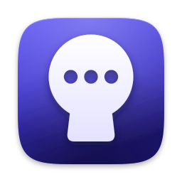

<p align="center">
  
</p>

<h1 align="center">Asiri</h1>

<p align="center"><b>Àṣírí</b> (Yoruba, <i>ah-shee-ree</i>): “secret”.<br>
A private, end-to-end encrypted messenger for macOS, built for a small circle of friends,<br>
with no third-party service in the middle.</p>

<p align="center">
  <a href="https://github.com/collinsadi/asiri/releases/latest"></a>
  <a href="https://github.com/collinsadi/asiri/actions/workflows/ci.yml"></a>
  <a href="https://github.com/collinsadi/asiri/actions/workflows/macos.yml"></a>
  
  <a href="LICENSE"></a>
</p>

---

Asiri lets a group of friends chat, share images and files, send voice notes, and make voice
calls, video calls and screen shares from their Macs. Everything is end-to-end encrypted with
**Messaging Layer Security** (MLS, RFC 9420) using a **hybrid post-quantum** cipher suite.
The only server is one you rent and control: a deliberately “dumb” relay that stores and
forwards ciphertext, reachable only as a **Tor onion service in restricted-discovery mode**,
plus a LiveKit media server for calls whose frames are end-to-end encrypted with keys derived
from each chat’s MLS group.

The full design lives in [`docs/architecture.md`](docs/architecture.md).

## Install

Download **Asiri-x.y.z.dmg** from the [latest release](https://github.com/collinsadi/asiri/releases/latest),
open it, and drag Asiri onto the Applications folder. It runs on macOS 14 Sonoma or later, on
Apple silicon and Intel, and it's signed with a Developer ID and notarized by Apple. Each
release lists how to check that the download is the one CI built from this repository.

**Joining a friend's server?** Give your AI coding agent [`docs/agent-setup.md`](docs/agent-setup.md):
it installs Asiri on your Mac and walks you through pairing. To build Asiri yourself, see
[Building from source](#building-from-source).

## Highlights

| | |
|---|---|
| **One protocol for everything** | Every chat is an MLS group (a DM is a two-person group), suite `MLS_256_XWING_CHACHA20POLY1305_SHA256_Ed25519` (X25519 + ML-KEM-768). Handshake and application messages are always `PrivateMessage`s, padded to a multiple of 256 bytes. |
| **A relay that knows nothing** | Random device/inbox IDs and a random `group_route` are all it sees. One commit per epoch per group, in a single `BEGIN IMMEDIATE` transaction, keeps every member in lock-step. |
| **No metadata leaks** | Messaging goes over embedded Tor (Arti) to an onion service that outsiders can’t even discover. No DNS, no CA, no push service, no analytics. |
| **Verified in person** | Friends pair by scanning each other’s QR codes and comparing six emoji. A 60-digit safety number covers remote verification. |
| **Encrypted at rest** | SQLCipher database whose key is wrapped by a Secure Enclave key when the build can use one (Settings › Security says so); optional Touch ID app lock, duress PIN and panic wipe (crypto-shredding). |
| **Invisible to screen capture** | Asiri's windows are left out of screenshots, screen recordings and screen sharing, its own included ([ADR-0007](docs/adr/0007-hidden-from-screen-capture.md)). |
| **Calls** | LiveKit SFU with AES-GCM frame encryption; call keys come from the MLS exporter and rotate with every epoch. |
| **A chat UI you’ll want to live in** | Telegram-style timeline with tailed bubbles, patterned wallpaper, reactions with bursts, replies, edits, voice notes with waveforms, a ⌘K switcher, and fast spring animations that respect Reduce Motion. |

## Repository layout

```text
asiri/
├── Cargo.toml                 # Rust workspace: core, relay, tools
├── proto/                     # Protocol Buffers: asiri.relay.v1, asiri.app.v1, asiri.pairing.v1
├── core/
│   ├── asiri-proto/           # generated protobuf code, shared by client and server
│   ├── asiri-core/            # identity, MLS, encrypted store, Tor and relay transport, the engine
│   └── asiri-ffi/             # UniFFI bridge to Swift
├── server/
│   ├── asiri-relay/           # axum relay + admin CLI
│   └── deploy/                # docker compose, LiveKit, tor, nftables, systemd, installer
├── apps/macos/                # the native Mac app (SwiftUI) and its Swift packages
├── design/icon/               # the icon's masters
├── tools/
│   ├── asiri-sim/             # dev relay, headless clients, test buddy, malicious relay
│   ├── asiri-release/         # the offline release key and signed update manifests
│   ├── design/                # the app icon and the install window, drawn from code
│   ├── proto-gen/             # regenerates core/asiri-proto from proto/
│   ├── uniffi-bindgen/        # pinned bindings generator
│   └── release/               # the core, the app, the disk image and releases
├── scripts/                   # ship, e2e, deploy-vps, release, and CI's checks
└── docs/                      # architecture and threat model, security notes, ADRs, guides
```

## Building from source

### Prerequisites

* macOS 14 Sonoma or later (Apple silicon recommended) with Xcode 16 or later
* Rust (`rustup`; the toolchain is pinned in `rust-toolchain.toml` and installs itself)
* Homebrew, for XcodeGen (the ship script installs it when it's missing)

### One command

```bash
./scripts/ship.sh                  # every check and test suite, then build/Asiri.app
./scripts/ship.sh --run --demo     # …and open it on demo data (no server needed)
./scripts/ship.sh --run --local    # …and start a development relay on this Mac to join
./scripts/ship.sh --install        # …and copy it into /Applications
```

`ship.sh` runs the Rust format, lint and test suites (including the end-to-end simulator and a
malicious relay), builds the core into `AsiriCoreFFI.xcframework`, runs the Swift tests and
renders every screen to `build/snapshots/`, then builds a Release `Asiri.app`. It signs with
your Developer ID or Apple Development certificate when the keychain has one (if macOS asks
whether `codesign` may use its key, choose **Always Allow**), and ad hoc (for this Mac only)
otherwise.

### Try it on one Mac

```bash
./scripts/ship.sh --run --local                    # 1. Asiri plus a development relay
cargo run -q -p asiri-sim -- buddy --name Ben      # 2. in another terminal: a friend to talk to
```

In Asiri choose **Set up a server** and paste the code the relay printed. Then open **Add a
Friend in Person…**, paste Ben's code, and paste Asiri's reply back into Ben's terminal. Ben
answers your messages, reacts, and downloads your photos, files and voice notes, all over real
MLS through the relay. (The development relay skips Tor; never use it for real chats.)

### Run your own server

```bash
scripts/deploy-vps.sh ubuntu@your-server your-key.pem                 # install or update
scripts/deploy-vps.sh ubuntu@your-server your-key.pem --bootstrap '<key shown in Asiri>'
scripts/deploy-vps.sh ubuntu@your-server your-key.pem --status
```

The first command installs Docker, Tor, the relay and LiveKit, and locks the firewall down.
If the server already runs other services, it stops and lists them instead; add `--shared` to
install alongside them without touching their firewall ([ADR-0006](docs/adr/0006-shared-servers.md)).
Calls also need TCP 7881 and UDP 7882 open in your cloud provider's firewall (an AWS security
group, for example). In Asiri choose **Set up a server**: it shows the `--bootstrap` command
with your Mac's key, and the code that command prints makes this Mac the server's admin.
[`server/deploy/README.md`](server/deploy/README.md) has the details.

### Pieces individually

```bash
cargo test --workspace                          # unit, relay and end-to-end tests
./scripts/e2e.sh                                # the simulator suites, plus LiveKit in Docker
cargo run -p asiri-sim -- relay                 # a development relay on 127.0.0.1:8080
cargo run -p asiri-sim -- demo                  # three simulated people chatting
./tools/release/build-xcframework.sh            # Rust core → AsiriCoreFFI.xcframework
./tools/release/build-app.sh                    # Asiri.app (Release) around it, in build/
(cd apps/macos/Packages/AsiriKit && swift test) # the Swift tests and screen snapshots
(cd apps/macos && xcodegen generate)            # the Xcode project, then open Asiri.xcodeproj
```

### Releases

```bash
scripts/release.sh 1.2.0                                   # tag it: CI builds, signs, notarizes, publishes
tools/release/sign-update.sh 1.2.0 --key /Volumes/Offline/release.key
scripts/deploy-vps.sh ubuntu@your-server your-key.pem --publish dist/latest.json dist/Asiri-1.2.0.dmg
```

Every version tag becomes a GitHub release: a signed, notarized disk image that opens on an
install window, with its checksum and a provenance attestation. Asiri checks for updates once a
day through the relay, verifies the manifest against the release key built into the app and
the disk image against the manifest, and then offers it. The release key stays offline; see
[`docs/releasing.md`](docs/releasing.md).

## Status

Asiri follows the milestones in [§19 of the architecture](docs/architecture.md#19-roadmap).
Until an independent security audit has been completed, **use it with test data only**.

## Contributing

Read [`CONTRIBUTING.md`](CONTRIBUTING.md) for the commit rules and development workflow, and
[`SECURITY.md`](SECURITY.md) for how to report a vulnerability.

## License

Copyright 2026 Collins Adi. Licensed under the [Apache License, Version 2.0](LICENSE).
