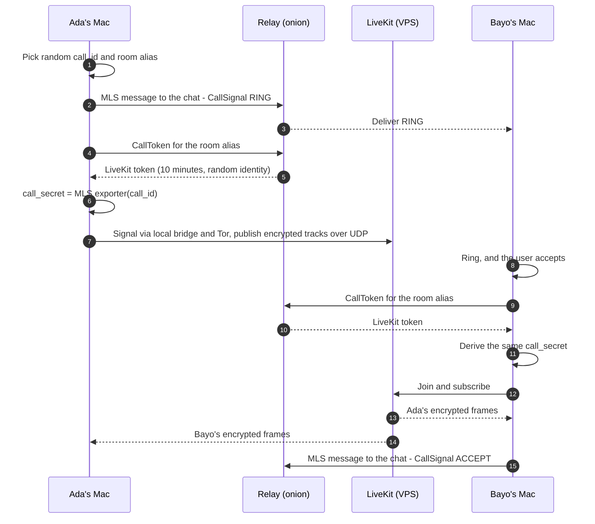
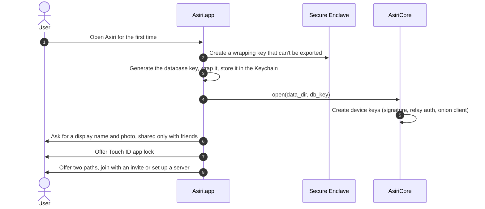
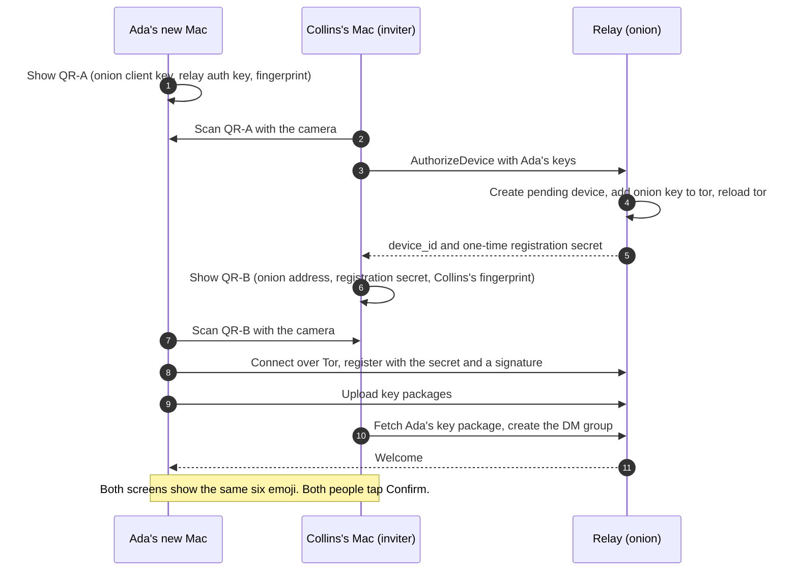
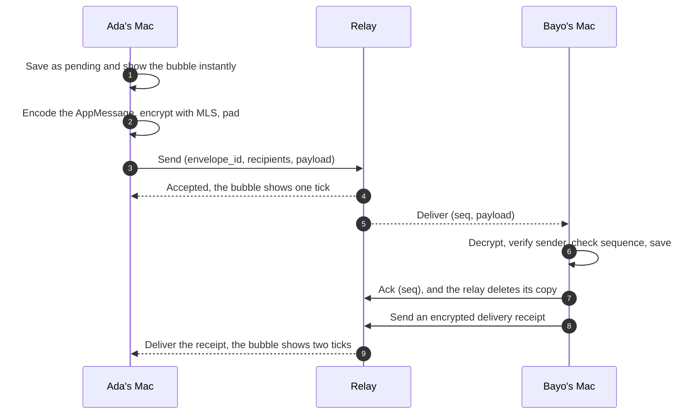

# Asiri: Architecture and Technical Design

> **Àṣírí** (Yoruba, pronounced *ah-shee-ree*) means "secret".
> Asiri is a private, end-to-end encrypted messenger for macOS, built for a small circle of friends, with no third-party service in the middle.

| Field | Value |
|---|---|
| Document | Architecture and technical design |
| Version | 0.2 |
| Date | 3 November 2026 |
| Owner | Collins |
| Platform | macOS 14 Sonoma or later |
| Status | Accepted, and built in Asiri 0.1.0 except where an ADR in [docs/adr](adr/) records a change. Unchecked items in §14 are still open |

---

## Contents

1. [Summary](#1-summary)
2. [Goals and non-goals](#2-goals-and-non-goals)
3. [Threat model](#3-threat-model)
4. [System overview](#4-system-overview)
5. [Tech stack](#5-tech-stack)
6. [Mac client architecture](#6-mac-client-architecture)
7. [Cryptographic design](#7-cryptographic-design)
8. [Networking](#8-networking)
9. [Relay server](#9-relay-server)
10. [Calls and screen sharing](#10-calls-and-screen-sharing)
11. [Core flows](#11-core-flows)
12. [App message protocol](#12-app-message-protocol)
13. [UI and UX design](#13-ui-and-ux-design)
14. [Security hardening checklist](#14-security-hardening-checklist)
15. [Infrastructure and deployment](#15-infrastructure-and-deployment)
16. [Releases and updates](#16-releases-and-updates)
17. [Repository layout](#17-repository-layout)
18. [Testing strategy](#18-testing-strategy)
19. [Roadmap](#19-roadmap)
20. [Risks and mitigations](#20-risks-and-mitigations)
21. [Alternatives considered](#21-alternatives-considered)
22. [Open questions](#22-open-questions)
23. [Glossary](#23-glossary)
24. [References](#24-references)

---

## 1. Summary

Asiri lets a group of friends who live in the same city, but not in the same home, chat, share images and files, and make voice calls, video calls and screen shares from their MacBooks. Everything is end-to-end encrypted. No messaging company, cloud service or push-notification service is involved.

**The design in one paragraph.** A native macOS app (SwiftUI and AppKit) runs on a shared Rust core. Every chat, one-to-one or group, uses the Messaging Layer Security protocol (MLS, RFC 9420) through the OpenMLS library, with a hybrid post-quantum cipher suite. The only server is one you rent and control. It runs a "dumb" relay that stores and forwards ciphertext, and a LiveKit media server for calls. The relay is reachable only as a Tor onion service in restricted-discovery mode, so outsiders can't even connect to it, and your internet provider can't see who you're messaging. Calls use LiveKit's end-to-end encryption with keys derived from each chat's MLS group, so the media server only ever forwards encrypted frames.

### Key decisions

| # | Decision | Why |
|---|---|---|
| D1 | Native Mac app: SwiftUI, with AppKit for the message timeline | Speed and feel on par with Telegram's native Mac app, and no bundled browser engine to attack |
| D2 | Shared Rust core, bridged to Swift with UniFFI | Memory safety for all crypto, storage and networking; reusable for an iPhone app later |
| D3 | MLS (OpenMLS) for every chat; a DM is a two-person group | One protocol for DMs and groups, with forward secrecy and post-compromise security |
| D4 | Hybrid post-quantum suite `MLS_256_XWING_CHACHA20POLY1305_SHA256_Ed25519` | Recorded traffic stays safe even against future quantum computers |
| D5 | One self-hosted relay that only sees ciphertext and random IDs | WhatsApp-style delivery while friends are offline, without trusting a company |
| D6 | Relay reachable only as a Tor onion service with restricted discovery | No domain, DNS, certificate authority or open ports; ISPs can't see who talks to whom |
| D7 | Self-hosted LiveKit with end-to-end encryption, keys taken from MLS | Production-grade group calls and screen sharing; the server never sees media |
| D8 | Identities are keys, verified in person by QR code | No phone numbers or emails; the server can't impersonate anyone |
| D9 | No push services, analytics, crash reporters or third-party SDKs | Nothing outside your control logs activity |

---

## 2. Goals and non-goals

### Goals

- **G1: End-to-end encryption for everything.** Text, images, files, voice notes, reactions, receipts, typing indicators, profile data, calls and screen sharing.
- **G2: No third-party service in the loop.** No messaging company, cloud backend, push service, analytics or crash reporting. The only infrastructure is a server you control.
- **G3: Minimal metadata.** The server knows random IDs, not people. It never stores names, phone numbers, contact lists or group names.
- **G4: A WhatsApp/Telegram-level experience.** Instant-feeling sends, smooth scrolling, rich media, reactions, replies, read receipts, typing indicators and search.
- **G5: DMs and group chats,** with up to 50 members per group.
- **G6: Voice and video calls with screen sharing,** one-to-one and in groups (up to about 10 people on video).
- **G7: Post-quantum confidentiality** for everything protected by MLS.
- **G8: Verifiable identity.** Friends verify each other in person once. After that, impersonation by the server or the network is detected and blocked.

### Non-goals for v1

- **N1:** Hiding the fact that you use Tor from a determined network observer. Tor bridges reduce this (see [§8.8](#88-censorship-resilience)).
- **N2:** Anonymity between friends. You know each other.
- **N3:** Protection against a fully compromised Mac (spyware with system access) or against a group member who screenshots or forwards messages.
- **N4:** iPhone, Windows, Android or web apps. The Rust core keeps that door open.
- **N5:** Federation with other servers, public sign-up or user discovery.
- **N6:** Large groups or broadcast channels (more than 50 members).

---

## 3. Threat model

### 3.1 What we protect

| Asset | Examples |
|---|---|
| Content | Messages, images, files, voice notes, call audio and video, screen content |
| Social graph | Who talks to whom, who is in which group |
| Activity patterns | When people message, call, or are online |
| Identity keys | Device signing keys, which prove who sent what |
| Local history | Messages and media stored on each Mac |

### 3.2 Adversaries

| ID | Adversary | What we assume they can do |
|---|---|---|
| A1 | Internet providers and network observers | See, log and store all traffic leaving your homes |
| A2 | The VPS hosting company | Read the server's disk, memory and network traffic |
| A3 | Someone who hacks the server | Everything A2 can, plus change the relay's behavior: drop, delay, replay or inject messages |
| A4 | Outsiders on the internet | Try to find, connect to or abuse the relay |
| A5 | A thief, or anyone holding a locked Mac | Has the disk, but not the login password |
| A6 | A future quantum attacker | Records encrypted traffic today and tries to decrypt it years from now |

### 3.3 Who can see what

| Party | Can see | Cannot see |
|---|---|---|
| Your ISP (A1) | That you use Tor; during calls, encrypted UDP traffic to your VPS's IP address, with timing and volume | Any content, who you message, the relay's address |
| VPS host (A2) | Encrypted queues and files on disk; Tor traffic; encrypted call media coming from friends' IP addresses | Any content or names; who sent which message (messages arrive over Tor) |
| A hacked relay (A3) | Random device IDs, which IDs share a group, padded message sizes and timing. It can drop or delay messages | Any content, names, profiles or group names. It can't forge or alter messages without detection |
| A hacked LiveKit server (A3) | That random participant aliases joined a call, when, and from which IP address | Audio, video or screen content |
| Outsiders (A4) | Nothing. The onion service can't be reached without an authorized device key | Everything |
| A thief with a locked Mac (A5) | Nothing useful (FileVault, encrypted database, Secure Enclave-wrapped keys) | Messages, media, keys |
| Apple | That your signed app exists, and routine signature checks when apps launch | Messages, contacts or calls (no iCloud sync, no Apple push service) |
| A group member | What's shared in that group | Other chats |

### 3.4 Residual risks

These risks are accepted, or reduced by measures described elsewhere in this document.

- **A compromised Mac.** Spyware with system access can read the screen and keystrokes. Mitigations: keep macOS updated, use Lockdown Mode if you're at high risk, app lock, short disappearing-message timers ([§14.4](#144-people-and-habits)).
- **Traffic correlation by a global observer.** Someone watching both your home connection and your VPS could match timing. Mitigations: Tor for messaging, padding, optional cover traffic later.
- **Call metadata.** Your ISP and VPS host can see that you're connected to the VPS during a call. Accepted, because Tor can't carry real-time media.
- **Message suppression.** A hacked relay can drop messages. Mitigation: per-sender sequence numbers let apps detect gaps and warn ([§12](#12-app-message-protocol)). Content stays safe either way.
- **Supply chain.** A compromised dependency could leak data. Mitigations: pinned and reviewed dependencies, no third-party SDKs ([§14.3](#143-build-and-release)).
- **Bugs in Asiri itself.** Mitigations: tests, fuzzing, and an independent audit before anyone relies on it ([§18](#18-testing-strategy)).

---

## 4. System overview

```text
+--------------------------------+                 +--------------------------------------+
| Each friend's Mac              |                 | Your VPS                             |
|                                |                 |                                      |
|  Asiri.app (SwiftUI + AppKit)  |                 |  tor onion service                   |
|        | UniFFI                |                 |  (restricted discovery)              |
|  AsiriCore (Rust)              |                 |     |-- :80   -> asiri-relay         |
|    OpenMLS + SQLCipher         |    Tor (TCP)    |     |           mailboxes, blobs     |
|    Arti Tor client             |<===============>|     |           (ciphertext only)    |
|    call signaling bridge       |                 |     '-- :7880 -> LiveKit signaling   |
|                                |                 |                                      |
|  LiveKit Swift SDK             |   direct UDP    |  LiveKit SFU  :7882/udp              |
|    E2EE audio, video, screen   |<--------------->|    forwards encrypted frames         |
+--------------------------------+                 +--------------------------------------+

  Your ISP sees Tor traffic, plus encrypted UDP to your VPS during calls. Never content.
```

### 4.1 Components

| Component | Runs on | Role |
|---|---|---|
| Asiri.app | Each Mac | User interface, notifications, calls (through the LiveKit Swift SDK) |
| AsiriCore | Each Mac, inside the app | MLS, encrypted storage, Tor, relay sync, attachment encryption, call keys |
| tor | VPS | Hosts the onion service and admits only authorized devices |
| asiri-relay | VPS | Mailboxes, key-package directory, ordering of group changes, encrypted file storage, call tokens |
| LiveKit server | VPS | Selective forwarding unit (SFU) for calls and screen sharing |

### 4.2 Data paths

| Traffic | Path | Protection |
|---|---|---|
| Messages, receipts, typing, group changes | Mac → Tor → onion service → relay → Tor → Mac | MLS end to end, plus Tor and onion-service encryption |
| Images, files, voice notes | Mac → Tor → relay file store → Tor → Mac | A fresh key per file, sent inside MLS, plus Tor |
| Call signaling (joining, leaving, track info) | Mac → local bridge → Tor → onion service → LiveKit | Tor and onion service; participant names are random aliases |
| Call media (audio, video, screen) | Mac ↔ VPS public IP over UDP (TCP fallback) | DTLS-SRTP to the server, plus LiveKit end-to-end frame encryption |

### 4.3 Why a server at all?

Purely peer-to-peer messengers need both people online at the same time, and they struggle with battery use and staying connected in the background. Briar, the best-known example, is now in maintenance mode, and its team cited exactly those problems. Laptops sleep and move between networks constantly. A small always-on relay that you control gives WhatsApp-style offline delivery, while only ever holding ciphertext it can't read.

---

## 5. Tech stack

### 5.1 Stack by layer

| Layer | Choice | Notes |
|---|---|---|
| Mac UI | SwiftUI for the app shell, settings and sheets; AppKit (`NSCollectionView` or `NSTableView`, `NSTextView`) for the message timeline and composer | macOS 14+, Observation framework (`@Observable`) |
| Swift–Rust bridge | UniFFI | Generates Swift bindings; Rust `async fn` maps to Swift `async`/`await` |
| Core language | Rust (stable), Tokio runtime | All crypto, storage and networking live here |
| End-to-end encryption | OpenMLS 0.9 or later with the `openmls_libcrux_crypto` provider (feature `draft-ietf-mls-pq-ciphersuites`) | libcrux provides formally verified ML-KEM and X25519 |
| Local database | SQLite through `rusqlite` with `bundled-sqlcipher`; MLS state through `openmls_sqlite_storage` | One encrypted file holds app data and MLS state |
| Key protection | Keychain (this device only, never synced) + Secure Enclave + LocalAuthentication (Touch ID) | Database key is wrapped by a hardware key |
| Tor client | Arti (`arti-client`, feature `onion-service-client`), embedded in the core | No separate Tor app to install |
| Relay protocol | WebSocket (`tokio-tungstenite`) and HTTP/1.1 (`hyper`) over Arti streams; Protocol Buffers (`prost`) | No TLS needed inside the onion connection |
| Attachment crypto | XChaCha20-Poly1305 in STREAM mode (`chacha20poly1305`), SHA-256 (`sha2`), HKDF (`hkdf`), `zeroize` | A fresh 256-bit key per file |
| Images | ImageIO and Core Image (re-encode to strip metadata), BlurHash placeholders | Location data never leaves the Mac |
| Calls and screen sharing | LiveKit Swift SDK (`client-sdk-swift`) with end-to-end encryption; ScreenCaptureKit through `MacOSScreenCapturer` | AES-GCM frame encryption with keys supplied by the app |
| In-person pairing | AVFoundation camera + Vision (`VNDetectBarcodesRequest`); Core Image QR generator | Works with the MacBook's built-in camera |
| Notifications | UserNotifications, local only | No Apple push service |
| Server OS | Debian 13 (or Ubuntu 24.04 LTS) | Minimal install |
| Relay server | Rust: `axum`, `tokio`, `rusqlite`, `prost`, `ed25519-dalek`, `hmac` (LiveKit tokens, minted directly) | One small binary |
| Tor on the server | C tor from the Tor Project's Debian repository | Mature onion-service hosting with restricted discovery |
| Media server | LiveKit server (open source, self-hosted, single node) | No Redis needed for one node |
| Server packaging | Docker Compose (relay, LiveKit), systemd (tor, helpers), nftables firewall | Images built on the server, not pulled from a third-party registry |
| Releases | Xcode, Developer ID signing, notarization, signed release manifest, in-app updater over Tor | See [§16](#16-releases-and-updates) |

### 5.2 Minimum requirements

- **Mac:** macOS 14 Sonoma or later. Apple silicon is recommended. The Secure Enclave is present on every Apple silicon Mac and on Intel Macs with a T2 chip; older Intel Macs fall back to Keychain-only protection. In-person pairing uses the built-in camera.
- **Server:** 2 vCPUs, 4 GB RAM, 40 GB SSD, a public IPv4 address, and at least 1 TB of monthly transfer.

**Bandwidth estimate.** A 720p camera stream uses roughly 1–1.5 Mbps and a 1080p screen share at 15 fps roughly 1–2.5 Mbps. In a five-person video call, the server sends each person the other four streams, so it pushes around 20–30 Mbps in total. Two hours of that every day adds up to roughly 0.7 TB a month. Text and images are negligible by comparison.

---

## 6. Mac client architecture

### 6.1 Layers

```text
+-------------------------------------------------------------+
| Asiri.app (Swift)                                           |
|   SwiftUI: chat list, conversation shell, settings,         |
|            pairing, call window                             |
|   AppKit:  message timeline, composer                       |
|   Platform: Keychain, Secure Enclave, Touch ID,             |
|             notifications, camera, LiveKit Swift SDK        |
+--------------------------- UniFFI --------------------------+
| AsiriCore (Rust, own Tokio runtime)                         |
|   identity  mls  store  net  sync  media  calls             |
|   pairing  updater  ffi                                     |
+-------------------------------------------------------------+
| OpenMLS + libcrux | SQLCipher | Arti | prost | RustCrypto   |
+-------------------------------------------------------------+
```

The Swift side owns everything the user sees and every Apple-specific service. The Rust core owns everything security-critical: keys, encryption, storage, networking and sync. Calls are the one exception: the LiveKit Swift SDK runs in the app layer, but the call keys come from the core.

### 6.2 Swift modules

The app target (`apps/macos/Asiri`) and three Swift packages under `apps/macos/Packages`:

| Module | Responsibility |
|---|---|
| `Asiri` (app target) | App lifecycle, the main, call and Settings windows, the menu bar extra, opening the database at launch, call coordination |
| `AsiriFeatures` (AsiriKit) | Every screen and its state: startup and onboarding, the chat list and ⌘K switcher, the conversation timeline and composer, pairing, calls, settings, updates, app lock |
| `AsiriDesign` (AsiriKit) | The design system: palette, bubbles, wallpaper, motion, QR codes, shared components |
| `AsiriDomain` (AsiriKit) | The app's models and `CoreService`, the boundary to the engine, plus `PreviewCore` for previews, tests and demo mode |
| `AsiriPlatform` (AsiriKit) | `KeyVault` (keychain and Secure Enclave key wrapping), the app lock, notifications, sleep and wake, launch at login, the camera, media preparation, the capture shield |
| `AsiriBridge`, `AsiriCoreKit` (AsiriCoreBridge) | The Rust core through its UniFFI bindings: `LiveCore` implements `CoreService` |
| `AsiriCalls` (AsiriCalls) | LiveKit call media: the room, end-to-end frame keys, video tiles, screen sharing |

### 6.3 Rust core modules

`asiri-core` (`core/asiri-core/src`), exposed to Swift by `asiri-ffi`:

| Module | Responsibility |
|---|---|
| `identity` | Device keys, credentials, fingerprints, safety numbers |
| `ids` | Identifiers, randomness and time |
| `crypto` | Building blocks outside MLS: attachment encryption, padding, emoji short authentication strings |
| `mls` | OpenMLS wrapper: groups, key packages, commits, Welcomes, exporter secrets, admin-policy checks |
| `store` | SQLCipher connection, schema migrations, the FTS5 search index, OpenMLS storage |
| `net` | Arti bootstrap and the onion dialer, the relay WebSocket client, HTTP, the call signaling bridge |
| `engine` | The API the app and the simulator use. Its submodules: `connection` (the connection loop), `outbound` and `inbound` (the outbox and inbox pipelines, acknowledgements, gap detection), `groups`, `media`, `calls`, `pairing`, `admin`, `updater` (the release manifest, verified against the release key), `maintenance`, and the `events` and `views` handed to the app |

### 6.4 Concurrency and state

- The core runs its own multi-threaded Tokio runtime. Swift calls its `async` functions, so long-running work never blocks the main thread.
- The core pushes events (`CoreEvent`: message received, status changed, typing, call ringing, connection state and so on) through a listener that Swift implements. A small adapter turns them into `AsyncStream`s consumed by `@MainActor` view models marked `@Observable`.
- **Outbox pattern.** Every outgoing message is saved locally as `pending` before any network activity, then sent with an idempotent envelope ID. The bubble appears instantly and its status updates when the relay accepts it.
- **Inbox pattern.** Incoming envelopes are decrypted and saved first, and only then acknowledged to the relay. A crash midway never loses a message; the relay simply redelivers it.

### 6.5 UniFFI surface (sketch)

Names and attributes are illustrative. Check the current UniFFI documentation for exact syntax.

```rust
// core/asiri-ffi/src/lib.rs
uniffi::setup_scaffolding!();

#[derive(uniffi::Object)]
pub struct AsiriCore { /* runtime, store, net, mls, ... */ }

#[uniffi::export(async_runtime = "tokio")]
impl AsiriCore {
    #[uniffi::constructor]
    pub fn open(data_dir: String, db_key: Vec<u8>, listener: Arc<dyn CoreListener>)
        -> Result<Arc<Self>, CoreError> { todo!() }

    pub async fn connect(&self) -> Result<(), CoreError> { todo!() }

    pub async fn send_text(&self, chat: ChatId, text: String, reply_to: Option<MessageId>)
        -> Result<MessageId, CoreError> { todo!() }

    pub async fn send_attachment(&self, chat: ChatId, path: String, caption: Option<String>)
        -> Result<MessageId, CoreError> { todo!() }

    pub async fn create_group(&self, name: String, members: Vec<ContactId>)
        -> Result<ChatId, CoreError> { todo!() }

    pub async fn start_call(&self, chat: ChatId, video: bool)
        -> Result<CallSession, CoreError> { todo!() }

    pub fn pairing_payload(&self) -> Result<Vec<u8>, CoreError> { todo!() }

    pub async fn complete_pairing(&self, scanned: Vec<u8>)
        -> Result<ContactId, CoreError> { todo!() }

    pub async fn panic_wipe(&self) -> Result<(), CoreError> { todo!() }
}

#[uniffi::export(with_foreign)]
pub trait CoreListener: Send + Sync {
    fn on_event(&self, event: CoreEvent);
}
```

### 6.6 Local storage and key hierarchy

```text
Secure Enclave key (P-256, can't be exported; Touch ID when app lock is on)
     |  wraps (ECIES)
     v
Database master key (256-bit random), stored wrapped in the Keychain
     |  unlocks
     v
SQLCipher database
   |-- chats, messages, contacts, settings, search index (FTS5)
   |-- MLS state: group secrets, signature keys, key packages
   |-- relay auth key
   '-- attachment keys  -->  encrypted attachment files in the app container
```

- **Database key.** 32 random bytes generated on first launch. It's wrapped with a Secure Enclave P-256 key using ECIES (`SecKeyCreateEncryptedData` with `.eciesEncryptionCofactorVariableIVX963SHA256AESGCM`) and stored as a Keychain item with `kSecAttrAccessibleWhenUnlockedThisDeviceOnly` and `kSecAttrSynchronizable = false`. It never reaches iCloud.
- **App lock.** When enabled, the Secure Enclave key requires user presence (`.userPresence`: Touch ID or the Mac password) before it can unwrap the database key.
- **One encrypted file.** OpenMLS state goes through `openmls_sqlite_storage` on the same SQLCipher-backed `rusqlite` connection. Pin matching `rusqlite` versions so the `bundled-sqlcipher` feature applies to both.
- **Search stays private.** Full-text search uses FTS5 inside the encrypted database. Asiri never uses Core Spotlight, which would copy message text into a system index.
- **Backups.** The app container is excluded from Time Machine (`isExcludedFromBackup`). A backup would be unreadable anyway, because the wrapping key never leaves the Secure Enclave. Losing a Mac means losing its history, by design.
- **Panic wipe.** Deleting the Secure Enclave key makes the database unreadable instantly ("crypto-shredding"). The files are deleted afterwards.

### 6.7 Running in the background

- Closing the window keeps Asiri running (`applicationShouldTerminateAfterLastWindowClosed` returns `false`), and a menu bar extra shows connection status and unread count.
- Launch at login is optional, through `SMAppService.mainApp`.
- **Sleep and wake.** Asiri listens for `NSWorkspace.willSleepNotification` and `didWakeNotification`, pauses timers before sleep, reconnects on wake, and fetches anything it missed.
- **Network changes.** `NWPathMonitor` triggers a reconnect when Wi-Fi changes.
- **App Nap.** Asiri opts out of App Nap only for the network loop while connected (a `ProcessInfo` activity), and the energy impact should be measured.
- **The trade-off of no push service.** Messages and calls arrive only while Asiri is running, even if just in the menu bar. That's the price of not routing anything through Apple's push service.

### 6.8 Notifications

| Level | Shows | Default |
|---|---|---|
| Private | "New message" | Yes |
| Sender only | "Ada sent a message" | No |
| Full preview | Sender and message text | No, with a warning when enabled |

macOS keeps its own copy of delivered notification text, which is why the private level is the default. Incoming calls use a local notification with Answer and Decline actions, plus a ringing window.

### 6.9 Sandbox, entitlements and permissions

| Item | Setting | Why |
|---|---|---|
| App Sandbox | `com.apple.security.app-sandbox` | Contains the damage from any bug |
| Outgoing network | `com.apple.security.network.client` | Tor and call media |
| Local listener | `com.apple.security.network.server` | The loopback-only call signaling bridge |
| Camera | `com.apple.security.device.camera`, plus `NSCameraUsageDescription` | QR pairing and video calls |
| Microphone | `com.apple.security.device.audio-input`, plus `NSMicrophoneUsageDescription` | Calls and voice notes |
| User-selected files | `com.apple.security.files.user-selected.read-write` | Attaching and saving files |
| Screen recording | System permission in Privacy & Security settings (no entitlement) | Screen sharing. macOS may ask users to re-confirm it from time to time |
| App Transport Security | `NSAllowsLocalNetworking = YES` | Lets LiveKit connect to the `ws://127.0.0.1` bridge without TLS |
| Hardened Runtime | On, with no JIT or unsigned-memory exceptions | Required for notarization; blocks code injection |

---

## 7. Cryptographic design

### 7.1 Principles

- **No home-made cryptography.** Asiri combines audited, standard building blocks (MLS, X-Wing, XChaCha20-Poly1305, SQLCipher, Tor). It never invents primitives or protocols.
- **The server is untrusted** for confidentiality and identity. The worst it can do is delay or drop messages.
- **Keys are born on the device** and never leave it unencrypted.
- **Secrets are short-lived in memory.** They're wiped after use (`zeroize`) and never logged.
- **Everything is versioned,** so the design can move to stronger algorithms (for example, post-quantum signatures) without breaking.

### 7.2 Keys and identities

| Key | Algorithm | Where it lives | Purpose | Rotation |
|---|---|---|---|---|
| Device signature key | Ed25519 | Encrypted database | Signs MLS messages; its fingerprint identifies the device | On compromise or re-pairing |
| MLS init keys (in key packages) | X-Wing (ML-KEM-768 + X25519) | Encrypted database; public halves on the relay | Let others add you to groups while you're offline | One-time use; expire after 30 days |
| MLS group secrets | MLS key schedule, per epoch | Encrypted database (OpenMLS storage) | Encrypt everything in each chat | Every membership change and self-update |
| Relay auth key | Ed25519 | Encrypted database | Proves to the relay that a device is registered | Yearly, or on compromise |
| Onion client key | X25519 (restricted discovery) | Arti's keystore in the app container, protected by FileVault and the sandbox | Lets the device reach the onion service at all; grants no other access | On compromise or revocation |
| Database master key | 256-bit random | Keychain, wrapped by the Secure Enclave | Unlocks SQLCipher | Re-key on demand |
| Secure Enclave wrapping key | P-256, can't be exported | Secure Enclave | Wraps the database key | Destroyed by panic wipe |
| Attachment keys | 256-bit random, one per file | Inside MLS messages and the encrypted database | Encrypt each image, file and voice note | Per file |
| Call keys | 256-bit, from the MLS exporter | Memory only | LiveKit end-to-end frame encryption | Per call and per epoch |
| Release signing key | Ed25519 | Offline (hardware key or air-gapped machine) | Signs app updates | Only on compromise |

### 7.3 MLS configuration

| Setting | Value | Why |
|---|---|---|
| Library | OpenMLS 0.9 or later with the `openmls_libcrux_crypto` provider | Maintained Rust MLS; libcrux has formally verified ML-KEM |
| Cipher suite | `MLS_256_XWING_CHACHA20POLY1305_SHA256_Ed25519`, behind the `draft-ietf-mls-pq-ciphersuites` feature | Hybrid post-quantum key exchange (X25519 + ML-KEM-768) |
| Fallback suite | `MLS_128_DHKEMX25519_CHACHA20POLY1305_SHA256_Ed25519` | Only if the post-quantum feature ever has to be turned off |
| Wire format | Ciphertext only (`PrivateMessage`) for application **and** handshake messages | The relay never sees proposals, commits or credentials in the clear |
| Ratchet tree | Delivered inside Welcome messages (ratchet-tree extension) | The server never stores a group's tree |
| Credentials | Basic credential holding only a random `user_id`, `device_id` and `inbox_id` | Key packages on the relay reveal nothing about people, and every member knows where to deliver |
| Padding | Pad every MLS ciphertext to a multiple of 256 bytes | Hides message length |
| Past epochs kept | 3 | Late messages sent just before a membership change still decrypt |
| Key packages | 20 one-time packages plus 1 last-resort package per device, 30-day lifetime | Others can add you while you're offline |
| Self-update | Every 7 days per active chat, and after waking from a long sleep | Post-compromise security: a stolen key soon stops working |

The X-Wing suite comes from an IETF draft that doesn't have a final code point yet. Asiri controls every client, so that's fine. Record each group's suite, and when final code points or fully post-quantum suites ship, move groups over with MLS's ReInit mechanism.

### 7.4 Chats are MLS groups

- Every chat is an MLS group with a random 32-byte group ID. A DM is simply a group containing both people's devices.
- Each group also gets a random 16-byte `group_route`. It's the only group identifier the relay ever sees, used to fan out messages and order group changes.
- Group name, avatar, description and admin list travel as encrypted app messages, never as metadata the server can read.
- **Ready for more devices.** Each device is its own MLS member. If someone adds an iPhone later, their Mac adds the new device to all of their groups.

### 7.5 Membership changes and admin rules

- **Add:** an admin fetches the new member's key package from the relay, creates a commit, sends the Welcome to the new member's inbox, and sends the commit to everyone else.
- **Remove:** an admin commits a Remove. The removed device can't decrypt anything from the next epoch onward.
- **Leave:** a member sends a self-remove proposal, and the next admin to come online commits it.
- **Admin policy:** an encrypted group-context extension, `asiri.admins`, lists admin user IDs. Every client checks every commit against it. Any member may commit their own key updates and their own removal; only admins may add or remove others. Clients reject, and warn about, commits that break the policy. In a DM, both people are admins.
- **Conflicts:** two commits for the same epoch can collide. The relay accepts only the first ([§9.5](#95-ordering-group-changes)); the other client fetches the winning commit, applies it and retries.

### 7.6 Verifying identities

- **In person (the default).** Friends meet once and scan each other's QR codes ([§11.2](#112-adding-a-friend-in-person)). Each QR carries the device's signature-key fingerprint, so a malicious relay can't substitute keys.
- **Emoji check.** After scanning, both screens show the same six emoji derived from both fingerprints. If they match, the contact is marked Verified.
- **Remote fallback.** A 60-digit safety number friends can compare over a call when meeting isn't possible. These contacts are labeled "Verified remotely".
- **Key changes.** A contact's new device is trusted automatically only if their already-verified device added it with a signed device-link message. Anything else shows a warning and stays blocked until it's verified again.

### 7.7 Attachment encryption

1. **Strip metadata.** Re-encode images from their pixels with ImageIO, which drops EXIF, GPS and camera data. Re-export videos without metadata through AVFoundation.
2. **Generate a fresh 256-bit key** for the file.
3. **Encrypt with XChaCha20-Poly1305 in STREAM mode** in 64 KiB chunks, so large files stream and any tampering or truncation is detected.
4. **Pad the ciphertext to a size bucket:** the next power of two up to 1 MiB, then the next multiple of 1 MiB.
5. **Upload over Tor** to the relay under a random blob ID, in resumable 1 MiB chunks.
6. **Send an MLS message** containing the blob ID, key, SHA-256 of the ciphertext, MIME type, dimensions, a tiny inline thumbnail and a BlurHash placeholder.
7. **Receivers download, verify the hash and keep the ciphertext** as their local copy, with the key stored in the encrypted database. Files are decrypted into memory when viewed.

Quick Look needs a plaintext file on disk, so Asiri uses its own viewer for images and video. Other file types are decrypted to a temporary file inside the app container, which is deleted when the preview closes.

### 7.8 Call keys

- `call_secret = MLS-Exporter(label = "asiri/call/v1", context = call_id, length = 32)`, passed to LiveKit as the shared key (base64-encoded).
- Every current member derives the same secret. The relay and LiveKit never see it.
- **Membership changes mid-call.** When a new epoch starts, every client derives a new secret, installs it at the next key index and switches to it (`setKey`, then `setCurrentKeyIndex`). A removed member can't follow the rest of the call.
- **Later:** per-participant keys, `HKDF(call_secret, "sender" || alias)`, to keep senders separate.
- **Reassurance:** the call window can show four emoji derived from `call_secret`. Friends can read them aloud to confirm they share the same keys.

```rust
// Illustrative; check the exact signature in your OpenMLS version.
let call_secret = group.export_secret(provider.crypto(), "asiri/call/v1", &call_id, 32)?;
```

### 7.9 Data at rest on the Mac

- **Database:** SQLCipher 4 (AES-256 page encryption with HMAC-SHA512 page authentication), opened in raw-key mode with the database master key.
- **Attachments:** kept as ciphertext, with their keys in the database.
- **FileVault:** checked on first launch, with a warning if it's off.
- **Panic wipe and duress PIN:** destroy the Secure Enclave key first, which makes everything unreadable instantly.

### 7.10 Post-quantum posture and "military level"

The NSA's CNSA 2.0 suite is the clearest public definition of "military-grade" algorithms. Here is how Asiri compares:

| Area | CNSA 2.0 | Asiri v1 | Asiri target |
|---|---|---|---|
| Key establishment | ML-KEM-1024 | X-Wing (ML-KEM-768 + X25519) | `MLS_256_MLKEM1024_AES256GCM_SHA384_MLDSA87`, once standardized and supported by OpenMLS |
| Signatures | ML-DSA-87 | Ed25519 | ML-DSA-87, in the same suite |
| Symmetric encryption | AES-256 | ChaCha20-Poly1305 and XChaCha20-Poly1305 (256-bit keys); AES-256 in SQLCipher | AES-256-GCM, in the same suite |
| Hashing | SHA-384 or SHA-512 | SHA-256 in MLS; SHA-512 in SQLCipher | SHA-384, in the same suite |

- **Key exchange is the urgent part.** Recorded ciphertext could be decrypted years from now, while forging a signature requires a quantum computer *during* the conversation. Asiri already protects key exchange, and can add post-quantum signatures later.
- **Calls inherit MLS protection.** Call keys come from the MLS exporter, so they benefit from the post-quantum key exchange too.
- **Tor is a separate layer.** It protects metadata. Message content is protected by MLS regardless of Tor's own cryptography.
- **What "military level" can't mean here.** Asiri isn't a certified military product. Certifications such as NSA Type 1 cover tamper-resistant hardware, emissions shielding, key distribution and procedures, all out of scope here. Asiri uses the same public algorithms and follows the same direction.

### 7.11 Things Asiri never does

- Invent primitives or protocols.
- Reuse a nonce. XChaCha20 nonces are random 192-bit values, and STREAM derives per-chunk nonces.
- Send private keys, call secrets or plaintext to any server.
- Take the relay's word on identity. Only verified fingerprints count.
- Log message content, keys or identifiers in release builds.
- Fall back silently to weaker cryptography. Failures are loud.

---

## 8. Networking

### 8.1 Two paths

- **Messaging traffic** (messages, files, group changes and call signaling) goes over Tor to the onion service.
- **Call media** goes directly over UDP to the VPS. Tor carries only TCP and adds too much delay for live audio and video.

### 8.2 Onion service with restricted discovery

- The relay is published only as a v3 onion service. There's no domain name, no DNS record, no TLS certificate and no open inbound port for messaging.
- **Restricted discovery** (formerly called "client authorization") encrypts the onion service's descriptor to a list of authorized client keys. A device that isn't on the list can't even find the service, let alone connect. Only devices you've paired can reach the relay at all.
- Each device has its own X25519 client key, so a lost Mac can be revoked on its own.
- Onion connections are encrypted end to end and authenticated by the onion address itself. No certificate authority is involved.

### 8.3 Embedded Tor (Arti)

- AsiriCore embeds `arti-client` with the `onion-service-client` feature. Its state and cache directories live inside the app container.
- Tor bootstraps at launch. The UI shows "Connecting securely…" until the first circuit is ready, usually within a few seconds.
- One long-lived stream carries the WebSocket. File transfers open extra streams.
- The device's restricted-discovery key is stored in Arti's keystore, the same mechanism the `arti hsc key` commands use.

```rust
// Sketch; check the arti-client documentation for your version.
use arti_client::{StreamPrefs, TorClient};

// Build the config with the app container's directories
// (for example TorClientConfigBuilder::from_directories(state_dir, cache_dir)).
let tor = TorClient::create_bootstrapped(config).await?;

let mut prefs = StreamPrefs::new();
prefs.connect_to_onion_services(BoolOrAuto::Explicit(true)); // BoolOrAuto comes from tor-config

let stream = tor.connect_with_prefs((RELAY_ONION_ADDR, 80), &prefs).await?;
// `stream` implements AsyncRead + AsyncWrite: run the WebSocket or HTTP client over it.
```

### 8.4 Relay connection lifecycle

1. Bootstrap Tor and open a stream to `<onion>:80`.
2. Upgrade to a WebSocket at `/v1/ws`.
3. The relay sends a random challenge. The device signs `"asiri-relay-auth-v1" || challenge || onion address` with its relay auth key.
4. The relay delivers queued envelopes in order. The device decrypts, stores and acknowledges them in batches.
5. **Heartbeat:** a ping every 45 seconds plus random jitter. If no pong arrives within 20 seconds, reconnect.
6. **Reconnect:** exponential backoff from 1 to 60 seconds with jitter, and an immediate retry on wake or network change.

### 8.5 Files over Tor

- Files travel over HTTP/1.1 on a separate Arti stream, uploaded in 1 MiB chunks with explicit offsets so interrupted uploads resume where they stopped.
- Downloads also resume, and the SHA-256 hash is checked before decrypting.
- Tor is slower than a direct connection, so a photo of a few megabytes usually takes a few seconds. The UI shows progress and stays responsive.

### 8.6 Call signaling bridge

- LiveKit's signaling runs over a WebSocket. During a call, and only then, the core opens a listener on `127.0.0.1` with a random port and forwards each connection over Tor to `<onion>:7880`.
- The LiveKit Swift SDK connects to `ws://127.0.0.1:<port>` with a short-lived access token. App Transport Security allows this because of `NSAllowsLocalNetworking`.
- The bridge closes as soon as the call ends. Another app on the same Mac could connect while it's open, but it would still need a valid token.
- **Interim option for early milestones:** put LiveKit's signaling on a domain with TLS. It's simpler, but it adds a domain registrar, DNS and a certificate authority, so switch to the bridge before v1.

### 8.7 Call media path

- LiveKit advertises the VPS's public IP address in its connection candidates (`use_external_ip: true`).
- Media uses a single UDP port (7882, LiveKit's UDP mux), with TCP port 7881 as a fallback for networks that block UDP.
- LiveKit is an SFU, so media never flows directly between friends. Nobody learns anyone else's IP address, and ISPs only see each person talking to the VPS.

### 8.8 Censorship resilience

- If Tor is blocked or throttled, users can turn on bridges (obfs4 or Snowflake) in Settings → Network. Arti supports bridges and pluggable transports. This requires bundling a signed pluggable-transport binary (such as lyrebird) in the app.
- Ship a few bridge lines with the app, and let users paste new ones shared in person or inside Asiri.

### 8.9 Metadata hygiene

- **No DNS lookups** for messaging: onion addresses resolve inside Tor.
- **No clearnet requests** except call media to the VPS. No remote images, web fonts or CDNs.
- **Link previews** are off by default. When enabled, the sender's app fetches the preview over Tor and sends it inside the encrypted message, so receivers never contact the linked site.
- **Timestamps** travel only inside encrypted messages. The relay stores expiry times, not send times.

---

## 9. Relay server

The relay (`asiri-relay`) is deliberately simple: a mailbox service that moves ciphertext between devices it knows only by random IDs.

### 9.1 Responsibilities

**The relay does:**

- Keep a registry of devices, known only by random IDs and public keys.
- Hold a mailbox (inbox queue) for each device and deliver envelopes in order.
- Store and hand out MLS key packages.
- Accept only one commit per epoch for each group.
- Store encrypted files for a limited time.
- Mint short-lived LiveKit access tokens for registered devices.
- Authorize and revoke devices, including their onion restricted-discovery keys.

**The relay never:**

- Sees or stores plaintext, names, phone numbers, contact lists, profiles or group names.
- Sends push notifications.
- Keeps access logs, analytics or long-term history. It never sees IP addresses, because all messaging traffic arrives through Tor.

### 9.2 API

Both the WebSocket and HTTP endpoints are reachable only through the onion service. Messages are encoded as Protocol Buffers.

| Kind | Endpoint or frame | Authentication | Purpose |
|---|---|---|---|
| HTTP | `POST /v1/register` | One-time registration secret + signature | Activate a device that an existing member authorized |
| WebSocket | `GET /v1/ws` | Challenge and response | Real-time session |
| Frame | `Send` | Session | Deliver one payload to a list of inboxes (the server fans out). Commits include `group_route` and `epoch` |
| Frame | `Deliver` (server to client) | Session | The next envelope from the device's inbox |
| Frame | `Ack` | Session | Confirms the envelope is stored, so the relay deletes it |
| Frame | `PutKeyPackages` | Session | Upload or replace key packages |
| Frame | `FetchKeyPackage` | Session | Take one key package for a given device |
| Frame | `AuthorizeDevice` | Session (subject to invite policy) | Pre-register a new friend's device and its onion client key |
| Frame | `RevokeDevice` | Session (your own devices, or an admin) | Remove a lost or retired device |
| Frame | `CallToken` | Session | Get a LiveKit token for a room alias |
| HTTP | `PUT /v1/blobs/{id}` | Session token | Upload an encrypted file in chunks |
| HTTP | `GET /v1/blobs/{id}` | Session token | Download an encrypted file (supports `Range`) |
| HTTP | `GET /v1/releases/latest` | Session token | Signed release manifest for the updater |
| HTTP | `GET /v1/health` | Session token | Health check |

### 9.3 Relay protocol (Protocol Buffers, condensed)

```proto
syntax = "proto3";
package asiri.relay.v1;

message ClientFrame {
  uint64 req_id = 1;
  oneof body {
    AuthResponse auth = 2;
    Send send = 3;
    Ack ack = 4;
    PutKeyPackages put_key_packages = 5;
    FetchKeyPackage fetch_key_package = 6;
    AuthorizeDevice authorize_device = 7;
    RevokeDevice revoke_device = 8;
    CallTokenRequest call_token = 9;
    Ping ping = 10;
  }
}

message ServerFrame {
  uint64 req_id = 1; // 0 for frames the server initiates
  oneof body {
    AuthChallenge challenge = 2;
    AuthOk auth_ok = 3;
    Deliver deliver = 4;
    SendResult send_result = 5;
    KeyPackage key_package = 6;
    DeviceAuthorized device_authorized = 7;
    CallToken call_token = 8;
    Error error = 9;
    Pong pong = 10;
  }
}

enum PayloadKind {
  PAYLOAD_KIND_UNSPECIFIED = 0;
  PAYLOAD_KIND_APPLICATION = 1; // MLS PrivateMessage carrying app content
  PAYLOAD_KIND_COMMIT = 2;      // MLS PrivateMessage carrying a commit (ordered by the relay)
  PAYLOAD_KIND_PROPOSAL = 3;    // MLS PrivateMessage carrying a proposal
  PAYLOAD_KIND_WELCOME = 4;     // MLS Welcome for a new member
  PAYLOAD_KIND_DEVICE_LINK = 5; // Signed message linking a new device to a user
}

message Send {
  bytes envelope_id = 1;         // 16 random bytes; makes retries idempotent
  PayloadKind kind = 2;
  bytes group_route = 3;         // required for commits
  uint64 epoch = 4;              // required for commits: the epoch being committed from
  repeated bytes to_inboxes = 5; // recipients; the server fans out
  bytes payload = 6;             // padded MLS message
  uint32 ttl_seconds = 7;        // optional; capped by server policy
}

message SendResult {
  enum Status {
    STATUS_UNSPECIFIED = 0;
    STATUS_ACCEPTED = 1;
    STATUS_STALE_EPOCH = 2;
    STATUS_UNKNOWN_INBOX = 3;
    STATUS_TOO_LARGE = 4;
    STATUS_RATE_LIMITED = 5;
  }
  Status status = 1;
  uint64 current_epoch = 2;      // set with STATUS_STALE_EPOCH
}

message Deliver {
  uint64 seq = 1;                // per-inbox sequence number
  bytes envelope_id = 2;
  PayloadKind kind = 3;
  bytes payload = 4;
}

message Ack { repeated uint64 seqs = 1; }

message AuthChallenge { bytes nonce = 1; }
message AuthResponse { bytes device_id = 1; bytes signature = 2; }
message AuthOk { bytes session_token = 1; uint32 protocol_version = 2; } // token also used for HTTP calls

message PutKeyPackages { repeated bytes key_packages = 1; bytes last_resort = 2; }
message FetchKeyPackage { bytes device_id = 1; }
message KeyPackage { bytes device_id = 1; bytes key_package = 2; }

message AuthorizeDevice { bytes onion_client_key = 1; bytes auth_pubkey = 2; }
message DeviceAuthorized { bytes device_id = 1; bytes inbox_id = 2; bytes registration_secret = 3; }
message RevokeDevice { bytes device_id = 1; }

message CallTokenRequest { string room_alias = 1; }
message CallToken { string jwt = 1; uint32 expires_in_s = 2; }

message Error { uint32 code = 1; string detail = 2; } // never echoes identifiers
message Ping { uint64 nonce = 1; }
message Pong { uint64 nonce = 1; }
```

### 9.4 Registering devices

1. **Bootstrap (once).** On the server, `asiri-relay admin bootstrap` takes the admin's onion client key (shown in the app's "Set up a server" screen), authorizes it with tor, and prints a one-time registration QR code. The admin's Mac scans it and registers as the first admin device.
2. **Adding a friend.** The inviter's app sends `AuthorizeDevice` with the new device's onion client key and relay auth key, which it got by scanning the new device's QR code. The relay creates a pending device, writes the onion key for tor, and returns a `device_id` and a one-time registration secret.
3. **Activation.** The new device connects over Tor (it's now authorized), calls `POST /v1/register` with the secret and a signature from its relay auth key, and uploads its key packages.
4. **Invite policy.** Configurable: only admins can authorize devices (default), or any member can.

The full in-person sequence is in [§11.2](#112-adding-a-friend-in-person).

### 9.5 Ordering group changes

MLS needs every member to apply commits in the same order. The relay enforces that with one rule: for each group, it accepts exactly one commit per epoch.

```text
on Send(kind = COMMIT, group_route = g, epoch = e), inside one database transaction:
    head = group_heads[g]                     # missing for a brand-new group
    if (head is missing and e == 0) or head == e:
        group_heads[g] = e + 1
        append the payload to every recipient inbox (same transaction, same order)
        return ACCEPTED
    else:
        return STALE_EPOCH(current_epoch = head)
```

- The transaction (`BEGIN IMMEDIATE` in SQLite) guarantees that two simultaneous commits can't both win.
- Writing every recipient's copy in the same transaction means all members see commits in the same order.
- Application messages and proposals aren't ordered by the relay; MLS handles them within an epoch.

### 9.6 Storage schema

```sql
-- Relay database: SQLite in WAL mode, with secure_delete on.
-- No names, no IP addresses, no activity timestamps.

CREATE TABLE devices (
  device_id        BLOB PRIMARY KEY,          -- 16 random bytes
  inbox_id         BLOB NOT NULL UNIQUE,      -- 16 random bytes
  auth_pubkey      BLOB NOT NULL,             -- Ed25519 relay auth key
  onion_client_key BLOB NOT NULL,             -- X25519 restricted-discovery public key
  is_admin         INTEGER NOT NULL DEFAULT 0,
  state            INTEGER NOT NULL           -- 0 pending, 1 active, 2 revoked
);

CREATE TABLE registrations (
  device_id        BLOB PRIMARY KEY REFERENCES devices(device_id),
  secret_hash      BLOB NOT NULL,             -- SHA-256 of the one-time secret
  expires_at       INTEGER NOT NULL           -- unix seconds
);

CREATE TABLE envelopes (
  inbox_id         BLOB NOT NULL,
  seq              INTEGER NOT NULL,          -- strictly increasing per inbox
  envelope_id      BLOB NOT NULL,
  kind             INTEGER NOT NULL,
  payload          BLOB NOT NULL,
  expires_at       INTEGER NOT NULL,
  PRIMARY KEY (inbox_id, seq),
  UNIQUE (inbox_id, envelope_id)
);

CREATE TABLE inbox_counters (
  inbox_id         BLOB PRIMARY KEY,
  next_seq         INTEGER NOT NULL
);

CREATE TABLE key_packages (
  id               INTEGER PRIMARY KEY,
  device_id        BLOB NOT NULL REFERENCES devices(device_id),
  key_package      BLOB NOT NULL,
  last_resort      INTEGER NOT NULL DEFAULT 0,
  expires_at       INTEGER NOT NULL
);

CREATE TABLE group_heads (
  group_route      BLOB PRIMARY KEY,          -- 16 random bytes chosen by the group creator
  epoch            INTEGER NOT NULL
);

CREATE TABLE blobs (
  blob_id          BLOB PRIMARY KEY,          -- 16 random bytes chosen by the uploader
  size             INTEGER NOT NULL,
  complete         INTEGER NOT NULL DEFAULT 0,
  expires_at       INTEGER NOT NULL           -- the file itself lives at blobs/<hex id>
);
```

### 9.7 Retention and deletion

| Data | Kept until | Then |
|---|---|---|
| Envelopes | Acknowledged, the sender's disappearing timer runs out, or 30 days pass | Row deleted and overwritten (`secure_delete`) |
| Encrypted files | 30 days after upload, or sooner if the sender's timer is shorter | File deleted |
| Key packages | Used or expired (30 days) | Deleted |
| Registration secrets | Used, or 24 hours | Deleted |
| Group heads | 180 days without a commit | Deleted |
| Revoked devices | 30 days after revocation | Deleted |
| Logs | Never written to disk | Not applicable |

### 9.8 Quotas and rate limits

| Limit | Value |
|---|---|
| Envelope size | 256 KiB (larger content goes as an encrypted file) |
| File size | 200 MiB |
| Stored files per device | 2 GiB |
| Sends | 600 per minute per device |
| Key-package fetches | 60 per hour per device |
| Device authorizations | 10 per day |
| Inbox backlog | 50,000 envelopes |

### 9.9 Logging policy

- Release builds log only warnings and errors, and never device IDs, inbox IDs, group routes or sizes.
- systemd's journal is set to `Storage=volatile`, so logs live in RAM only.
- tor keeps its default `SafeLogging`, and LiveKit runs with `logging.level: warn`.

### 9.10 Admin commands

```text
asiri-relay admin bootstrap --onion-client-key <key>   # first device; prints a registration QR
asiri-relay devices list                                # IDs, state, admin flag
asiri-relay devices revoke <device_id>
asiri-relay policy set invite admins|members
asiri-relay gc                                          # apply the retention rules now
asiri-relay release publish --manifest latest.json --file Asiri-1.2.0.dmg   # offer an update
```

On a server installed by the deployment kit, run them as `sudo asiri-admin …`, and publish
releases with `scripts/deploy-vps.sh … --publish` from your Mac ([docs/releasing.md](releasing.md)).

---

## 10. Calls and screen sharing

### 10.1 Overview

- One-to-one and group voice and video calls, plus screen sharing, all through LiveKit on your VPS.
- Frames are encrypted end to end (AES-GCM) with keys derived from the chat's MLS group ([§7.8](#78-call-keys)).
- On the suggested VPS, about 10 people on video is a comfortable target. Audio-only calls can hold more.

### 10.2 Call flow



### 10.3 LiveKit server configuration

The installer renders [`server/deploy/livekit.yaml.template`](../server/deploy/livekit.yaml.template)
into `/opt/asiri/livekit.yaml`:

- Signaling on port 7880 listens on 127.0.0.1 only and is reached through the onion service.
- All media uses one public UDP port (7882), with a TCP fallback on 7881. LiveKit advertises the
  server's public IPv4 address (`node_ip`). There's no TURN: native clients reach those ports
  directly.
- The API key and secret are in a key file (`key_file`) that only LiveKit and the relay can
  read. The relay uses them to mint tokens.
- Rooms close 60 seconds after they empty, and hold at most 12 people. Logs are warnings only.

### 10.4 Minting call tokens on the relay

A LiveKit access token is an HS256 JWT signed with the API secret, so the relay mints it
directly with HMAC-SHA256 ([`server/asiri-relay/src/livekit.rs`](../server/asiri-relay/src/livekit.rs))
rather than pulling in the LiveKit server SDK and its dependencies. Each token:

- names a random alias as its identity, never a device ID or a person's name;
- grants joining one room, by its alias, with publishing, subscribing and data;
- expires after 10 minutes.

### 10.5 Client setup with end-to-end encryption

```swift
import LiveKit

// callSecretBase64 comes from AsiriCore (the MLS exporter).
let keyProvider = BaseKeyProvider(isSharedKey: true, sharedKey: callSecretBase64)
let encryption = EncryptionOptions(keyProvider: keyProvider, encryptionType: .gcm)
let e2ee = E2EEManager(options: encryption)

let room = Room()
room.e2eeManager = e2ee
e2ee.setup(room: room)

// bridgeURL is ws://127.0.0.1:<port>, served by AsiriCore's signaling bridge.
try await room.connect(url: bridgeURL, token: liveKitToken)
try await room.localParticipant.setMicrophone(enabled: true)
try await room.localParticipant.setCamera(enabled: isVideoCall)

// When the MLS epoch changes mid-call:
keyProvider.setKey(key: nextSecretBase64, index: nextIndex)
keyProvider.setCurrentKeyIndex(nextIndex)
```

- LiveKit is renaming parts of its encryption API (from `e2ee` to `encryption`), so follow the docs for the SDK version you pin.
- Show "Encrypted" in the call window only after the room reports encryption as active (the `didUpdateE2EEState` delegate). If someone's frames can't be decrypted (`missingKey`), show a warning on their tile.

### 10.6 Screen sharing

```swift
// List displays and windows for the picker, leaving out Asiri's own windows.
let sources = try await MacOSScreenCapturer.sources(for: .any, includeCurrentApplication: false)
let picked = sources[selectedIndex]   // chosen in your picker UI

let screenTrack = LocalVideoTrack.createMacOSScreenShareTrack(
    source: picked,
    options: ScreenShareCaptureOptions(dimensions: .h1080_169, fps: 15, showCursor: true)
)
try await room.localParticipant.publish(videoTrack: screenTrack)
```

- **Picker:** thumbnails of displays and windows from `MacOSScreenCapturer.displaySources()` and `windowSources()`.
- **Presets:** "Text and slides" (1080p at 15 fps) and "Motion" (720p at 30 fps).
- **Permission:** screen sharing needs the Screen & System Audio Recording permission. Show a one-time explainer with a button that opens the right pane in System Settings.
- **Privacy reminder:** when someone shares a whole display, remind them that any Asiri chat visible on screen will be shared too.

### 10.7 Quality and reliability

- **Audio:** Opus (LiveKit's default) with WebRTC's built-in echo cancellation and noise suppression.
- **Video:** simulcast on, with adaptive stream and dynacast, so the server only forwards the quality layers someone is actually watching.
- **Reconnects:** LiveKit resumes through brief network changes. If the room drops, rejoin with a fresh token and the same call secret.
- **Targets:** join within 3 seconds once Tor is warm; mouth-to-ear audio delay under 250 ms within the city (depends on how close the VPS is).

### 10.8 Limits

- Server-side recording or transcription is impossible by design, because the server only sees encrypted frames.
- The relay and LiveKit know that random aliases joined a room, and when.
- ISPs and the VPS host can see encrypted call traffic between each friend and the VPS.

---

## 11. Core flows

The diagrams use Mermaid, which GitHub, VS Code and most Markdown editors render.

### 11.1 First launch



The "Set up a server" path shows the admin's onion client key, which the admin passes to `asiri-relay admin bootstrap` ([§9.4](#94-registering-devices)).

### 11.2 Adding a friend in person

This is the moment that makes Asiri trustworthy: two friends, in the same room, exchanging keys directly.



- Each QR code holds about 150 bytes, so it scans easily. Hold the two laptops facing each other; the scanning Mac shows a mirrored camera preview.
- If the camera can't read the other screen, iPhone Continuity Camera works too.
- **Friends who already use Asiri** skip the relay steps. They scan each other's contact QR codes (fingerprint, device ID and inbox), compare emoji, and a DM group is created.

### 11.3 Sending a message



If Bayo is offline, the envelope waits in his inbox until his Mac reconnects. Ada sees one tick until then.

### 11.4 Creating a group and adding someone

1. The creator generates a group ID and a `group_route`, creates the MLS group with the X-Wing suite, and sets `asiri.admins` to themselves.
2. The creator fetches one key package for each member's device from the relay.
3. The creator commits Add proposals for everyone (epoch 0 to 1). The relay accepts this first commit for the new route.
4. Welcome messages go to each new device's inbox, followed by a `GroupUpdate` message with the group's name and photo.
5. Members process the Welcome, check every member against their verified contacts, and show the group. Anyone they haven't verified is clearly flagged.

**Adding someone later:** an admin fetches the newcomer's key package and commits an Add. The relay orders it, the newcomer gets a Welcome, and existing members get the commit. New members can't read anything sent before they joined; that's an MLS guarantee.

### 11.5 Sending an image

1. The user drops, pastes or picks an image. A thumbnail appears in the conversation immediately with a progress ring.
2. AsiriCore strips metadata, encrypts the file with a fresh key, pads it, and uploads it over Tor ([§7.7](#77-attachment-encryption)).
3. Once uploaded, an MLS message carries the blob ID, key, hash, thumbnail and BlurHash.
4. Receivers see the BlurHash and thumbnail at once, and download the full image in the background (automatically for images, with a size limit you can set for videos and files).
5. If the upload fails, the bubble shows a retry button, and uploads resume where they stopped.

### 11.6 Removing someone, or leaving

- **Removing:** an admin chooses "Remove from group". The app commits a Remove for every device of that person. The relay orders it, everyone moves to the new epoch, and the removed devices can't read anything from then on.
- **Leaving:** the member sends a self-remove proposal and deletes the chat locally. The next admin online commits the removal. Until then, the app no longer shows that group's messages to the person who left.

### 11.7 A Mac is lost or stolen

1. **Revoke it.** From another device you own, or by asking an admin, send `RevokeDevice`. The relay deletes the device and removes its onion key, so it can no longer even reach the server.
2. **Optional remote wipe.** Before revoking, queue a signed wipe instruction. If the lost Mac comes online first, it erases itself.
3. **Remove it from every chat.** The app offers "Remove Ada's old Mac from all chats", which commits Removes in every group. That also rotates every group's keys.
4. **The data on the lost Mac stays protected** by FileVault, the encrypted database and the Secure Enclave. With app lock on, even a thief with a logged-in Mac needs Touch ID or the password.
5. **Set up again.** The owner installs Asiri on a new Mac and pairs again in person.

### 11.8 If the server is compromised

1. **Content stays safe.** The server only ever held ciphertext.
2. **Build a new server** on a fresh VPS with a new onion address. Restore only configuration, never data.
3. **Move everyone.** While the old relay still works, an admin sends a `ServerMove` message (with the new onion address) inside every chat. Clients accept it only from admins. Each device replies to the admin, inside MLS, with fresh onion and relay keys; the admin authorizes them on the new server and sends back registration secrets the same way. If the old relay is already gone, re-pair in person.
4. **Rotate secrets:** new LiveKit API keys, and an automatic self-update commit in every chat after the move.
5. **Review** what the attacker could have learned: random IDs, group sizes, timing.

---

## 12. App message protocol

Everything inside an MLS application message is an `AppMessage` encoded with Protocol Buffers and then padded.

```proto
syntax = "proto3";
package asiri.app.v1;

message AppMessage {
  bytes message_id = 1;     // 16 random bytes
  uint64 sender_seq = 2;    // per sender device, per chat; gaps reveal dropped messages
  int64 sent_at_ms = 3;     // sender's clock
  uint32 expires_in_s = 4;  // disappearing timer; 0 means off
  bytes reply_to = 5;       // optional message_id
  oneof body {
    Text text = 10;
    Attachment attachment = 11;
    Reaction reaction = 12;
    Edit edit = 13;
    Delete delete = 14;
    Receipt receipt = 15;
    Typing typing = 16;
    ProfileUpdate profile = 17;
    GroupUpdate group = 18;
    CallSignal call = 19;
    TimerChange timer = 20;
    ServerMove server_move = 21;
  }
}

message Text {
  string body = 1;
  repeated Mention mentions = 2;
  LinkPreview link_preview = 3;  // optional, generated by the sender
}

message Mention { bytes user_id = 1; uint32 start = 2; uint32 length = 3; }

message LinkPreview { string url = 1; string title = 2; string description = 3; bytes image_jpeg = 4; }

message Attachment {
  bytes blob_id = 1;
  bytes key = 2;                 // 32-byte XChaCha20-Poly1305 STREAM key
  bytes ciphertext_sha256 = 3;
  uint64 size = 4;               // plaintext size
  string mime_type = 5;
  string file_name = 6;
  uint32 width = 7;
  uint32 height = 8;
  uint32 duration_ms = 9;        // audio and video
  bytes thumbnail_jpeg = 10;     // a few KB at most
  string blurhash = 11;
  string caption = 12;
  bool voice_note = 13;
  bytes waveform = 14;           // voice notes only
}

message Reaction { bytes target = 1; string emoji = 2; bool remove = 3; }
message Edit { bytes target = 1; Text text = 2; }
message Delete { bytes target = 1; }  // "delete for everyone"

message Receipt {
  enum Kind { KIND_UNSPECIFIED = 0; KIND_DELIVERED = 1; KIND_READ = 2; }
  Kind kind = 1;
  repeated bytes targets = 2;    // batched message IDs
}

message Typing { bool active = 1; }

message ProfileUpdate { string display_name = 1; Attachment avatar = 2; }

message GroupUpdate { string name = 1; Attachment avatar = 2; string description = 3; }

message CallSignal {
  enum Kind {
    KIND_UNSPECIFIED = 0;
    KIND_RING = 1;
    KIND_ACCEPT = 2;
    KIND_DECLINE = 3;
    KIND_JOINED = 4;
    KIND_LEFT = 5;
    KIND_END = 6;
  }
  Kind kind = 1;
  bytes call_id = 2;
  string room_alias = 3;
  bool video = 4;
  string participant_alias = 5;  // maps LiveKit aliases to people, only inside MLS
}

message TimerChange { uint32 seconds = 1; }

message ServerMove { string onion_address = 1; }  // accepted only from group admins
```

### Rules

- **Ordering.** Messages display by `sent_at_ms`, with ties broken by delivery order. Timestamps far in the future are clamped.
- **Gap detection.** Each app tracks the highest `sender_seq` per sender device and chat. If numbers are skipped and the missing ones don't arrive within a few minutes, the chat shows "Some messages from Ada may not have arrived."
- **Edits and deletes.** Only the device that sent a message can edit or delete it; MLS authenticates the sender. Edited messages show an "Edited" label; only the latest version is kept.
- **Receipts and typing** are optional in Settings. Typing indicators are never stored and expire after 10 seconds.
- **Disappearing messages.** The timer starts when a message is sent (for the sender) or received (for everyone else). Apps delete expired messages and their attachments locally, and the relay's retention never exceeds the timer.
- **Forward compatibility.** Unknown fields are ignored. An unknown message type shows "Update Asiri to see this message."

---

## 13. UI and UX design

### 13.1 Principles

1. **Instant.** Every action responds within one frame. Network work happens in the background.
2. **Native.** Standard Mac conventions: sidebar, toolbar, menus, keyboard shortcuts, drag and drop, right-click menus, system fonts and colors.
3. **Calm security.** Security appears as clear, quiet signals: a Verified badge, a lock in the call window. Warnings appear only when something is actually wrong.
4. **Keyboard first.** Everything is reachable without a mouse.
5. **Private by default.** Notification previews and link previews start off. Read receipts start on, and anyone can turn them off.

### 13.2 Main window

```text
+----------------------------------------------------------------------------------------+
| o o o                                                                                  |
+-----------------------+------------------------------------------+---------------------+
| [ Search      cmd+K ] | Ada Okafor          [Call] [Video]       | Ada Okafor          |
| All  Unread  Groups   | Verified in person - encrypted           | Verified in person  |
|                       |------------------------------------------| Safety number  >    |
| (A) Ada         9:41  |                  Today                   |                     |
|     See you at 6      |  .------------------------.              | Shared media        |
|                       |  | Are we still on for 6? |   9:38       | [img] [img] [img]   |
| (B) Bayo        9:02  |  '------------------------'              |                     |
|     Photo             |           .-------------------------.    | Disappearing msgs   |
|                       |           | Yes! Usual place.       |    | 1 week              |
| (#) The Squad    Tue  |           '-------------------------'    |                     |
|     Tolu: lol         |                         9:41  Read       | Notifications       |
|                       |                                          | Name only           |
|                       |------------------------------------------|                     |
|                       | [+]  Message...          [Mic] [Send]    |                     |
| [+ New chat]  [Gear]  |                                          | Mute     Block      |
+-----------------------+------------------------------------------+---------------------+
```

- Three panes in a `NavigationSplitView`: chats, conversation, and details. The details pane toggles with ⌥⌘I.
- The window remembers its size and position, and supports full screen.
- Chat list previews are generated locally from the decrypted database; nothing is fetched to build them.

### 13.3 Key screens

- **Chat list:** photo, name, last-message preview, time, unread badge, pinned chats on top, mute icon. Filters for All, Unread and Groups. ⌘K opens a quick switcher that searches chats and messages.
- **Conversation:** a header with name, verification state and call buttons. The timeline has date separators, grouped bubbles, quoted replies, reactions, "Edited" labels, delivery ticks, inline images (BlurHash, then thumbnail, then full image), voice notes with waveforms, and file cards. A jump-to-latest button shows the unread count.
- **Composer:** an auto-growing text field. Return sends; Shift-Return adds a line. Paste or drag in images and files, record voice notes, use the system emoji picker (⌃⌘Space), @-mention people in groups, reply, and press ↑ in an empty composer to edit your last message.
- **Media viewer:** an in-app, full-window viewer. Arrow keys browse, pinch or scroll zooms. "Save to…" exports a plaintext copy to a place the user chooses, with a one-time note that saved files are no longer protected by Asiri.
- **Call window:** a floating window that can stay on top. Grid or speaker view, tiles with mute and speaking indicators, a large screen share with a filmstrip, and controls for mic, camera, screen sharing and hanging up. It shows an "Encrypted" lock, an optional four-emoji check, and connection quality.
- **Pairing:** a large QR code, a camera preview for scanning, live guidance ("Hold the screens facing each other"), and the emoji confirmation screen.
- **Settings:**
  - **Profile:** name and photo.
  - **Privacy:** read receipts, typing indicators, notification level, link previews, default disappearing timer.
  - **Security:** app lock, duress PIN, panic wipe, verified devices, safety numbers.
  - **Network:** Tor status and bridges.
  - **Calls:** microphone, camera and noise suppression.
  - **Server** (admins only): devices, invites, health.
  - **About:** version, update check, your fingerprint.

### 13.4 Keyboard shortcuts

| Action | Shortcut |
|---|---|
| New chat | ⌘N |
| New group | ⇧⌘N |
| Quick switcher and search | ⌘K |
| Find in conversation | ⌘F |
| Next or previous chat | ⌃Tab or ⌃⇧Tab |
| Edit your last message | ↑ in an empty composer |
| Reply to the selected message | ⌘R |
| Attach a file | ⌘O |
| Mute or unmute (in a call) | ⇧⌘A |
| Camera on or off (in a call) | ⇧⌘V |
| Start or stop screen sharing | ⇧⌘S |
| Show or hide details | ⌥⌘I |
| Lock Asiri now | ⌘L |
| Settings | ⌘, |

### 13.5 Message status

| Indicator | Meaning |
|---|---|
| Clock | Saved on your Mac, waiting to send |
| One tick | Accepted by your relay |
| Two ticks | Delivered to every recipient's device |
| Two ticks in the accent color | Read (if the recipient shares read receipts) |
| Red exclamation mark | Couldn't send; click to retry |

### 13.6 Performance budgets

| Interaction | Budget |
|---|---|
| Cold launch to chat list | Under 1.5 s, including the Secure Enclave unlock (Tor connects in the background) |
| Warm launch | Under 0.5 s |
| Open a chat (last 50 messages) | Under 100 ms |
| Scrolling | 60 fps, or 120 fps on ProMotion displays, with no hitches while images load |
| Press Return to bubble on screen | Under 16 ms (one frame) |
| Delivery when both are online and Tor is warm | About 1–2 s |
| Search across 100,000 messages | Under 150 ms |
| Joining a call with Tor warm | Under 3 s |
| Memory after a day of normal use | Under 400 MB |

### 13.7 Making the timeline smooth

- Use `NSCollectionView` (or a view-based `NSTableView`) with cell reuse, wrapped for SwiftUI with `NSViewControllerRepresentable`. SwiftUI's `List` and `LazyVStack` can stutter with thousands of rows of varying heights.
- Anchor scrolling to the bottom: keep the newest message in view as new ones arrive, and keep the reading position steady when older pages load.
- Measure text (TextKit 2) and bubble sizes off the main thread, cached by message ID and width.
- Decode and decrypt images off the main thread. Show the BlurHash first, then the thumbnail, then the full image.
- Load history in pages of 100. Use a diffable data source so receipts and reactions update single cells, not the whole list.
- Animate with springs of about 0.25 s, and respect Reduce Motion.
- Profile with Instruments (Time Profiler and Animation Hitches) at every milestone.

### 13.8 Visual identity

- **Name:** Asiri (Àṣírí), Yoruba for "secret". Use "Àṣírí", with its tone marks, on the About screen and in onboarding, and "Asiri" everywhere else.
- **Tagline options:** "Between us." · "What's said here stays here." · "Your secrets, kept."
- **App icon concept:** a rounded speech bubble whose tail forms a keyhole, on deep indigo. Keep it clearly distinct from existing messenger icons.
- **Palette (suggestion):** Night `#14122B` for dark backgrounds, Indigo `#4F46E5` as the accent, Amber `#F5A524` for highlights such as unread badges and the Verified badge, plus macOS system grays. Check contrast in light and dark mode against WCAG AA.
- **Type:** SF Pro (the system font) for the interface; SF Mono for safety numbers and fingerprints.
- **Icons:** SF Symbols throughout, such as `lock.fill`, `checkmark.seal`, `phone`, `video`, `mic`, `paperclip` and `rectangle.on.rectangle`.
- **Voice:** plain and warm. "Connecting securely…", "Verified in person", "Only you and Ada can read this chat." Jargon such as "MLS" or "epoch" never appears in the interface.

### 13.9 Accessibility

- VoiceOver labels for every bubble (sender, time, status), button and call control.
- An in-app text size setting.
- WCAG AA contrast in both themes. Status never relies on color alone; ticks also differ in shape.
- Reduce Motion and Reduce Transparency are respected.
- Every action is reachable by keyboard, with visible focus rings.
- **Later:** on-device live captions for calls, so no audio ever leaves the Mac for transcription.

---

## 14. Security hardening checklist

### 14.1 Mac app

- [ ] App Sandbox and Hardened Runtime on, with no entitlements beyond §6.9.
- [ ] Database key wrapped by the Secure Enclave; its Keychain item is device-only and never synced.
- [ ] App lock with Touch ID. Locks when the Mac sleeps and after 15 minutes of inactivity (configurable).
- [ ] Duress PIN: entering it at the lock screen silently wipes Asiri and shows an empty app.
- [ ] Panic wipe in the menu bar extra, behind a confirmation.
- [ ] Notification previews off by default.
- [ ] No Core Spotlight indexing, iCloud, Handoff, or Siri and App Intents that expose message content.
- [ ] Optional: clear copied message text from the clipboard after 60 seconds if it hasn't changed.
- [ ] Metadata stripped from every image and video before sending.
- [ ] No remote content: no remote images, and no link fetching on the receiving side.
- [ ] Release builds log only errors, without identifiers, and have no debug menus.
- [ ] Secrets zeroized after use. Keys cross into Swift as bytes; base64 only at the LiveKit boundary.
- [ ] FileVault checked at first launch, with a warning if it's off.
- [ ] Every window is left out of screenshots, screen recordings and screen sharing (`sharingType = .none`) from its first frame ([ADR-0007](adr/0007-hidden-from-screen-capture.md)). That can't stop a camera pointed at the screen, so disappearing messages and trust between friends are the defense beyond it.

### 14.2 Server

- [ ] Minimal Debian install with automatic security updates (`unattended-upgrades`).
- [ ] Only two public ports: 7881/tcp and 7882/udp, for LiveKit media. nftables drops everything else.
- [ ] SSH only through a separate onion service with restricted discovery; key-based logins only. Keep the provider's web console as a break-glass option.
- [ ] Relay and LiveKit containers run as non-root, with read-only file systems, `no-new-privileges` and dropped capabilities.
- [ ] Optional disk encryption (LUKS). It protects drives the provider retires; it doesn't stop a provider with live access, which is why the server only holds ciphertext.
- [ ] Logs kept in RAM only (`Storage=volatile`), no access logs, tor's `SafeLogging` on.
- [ ] Backups contain only onion-service keys and configuration, encrypted and kept offline. Never messages.
- [ ] Secrets such as the LiveKit API secret live in files only root and the containers' secrets group can read (mode 640), never in the repository.
- [ ] Container images pinned and rebuilt monthly.
- [ ] Disk usage and service health visible to admins in Settings → Server.

### 14.3 Build and release

- [ ] Lock files committed (`Cargo.lock`, `Package.resolved`) and dependencies pinned.
- [ ] `cargo audit` and `cargo deny` in CI. Every new dependency reviewed before it's added (`cargo vet` optional).
- [ ] No third-party SDKs in the app besides LiveKit: no analytics, crash reporting or ad libraries.
- [ ] Two-factor authentication on the code host, and signed commits and tags.
- [ ] Release builds made on a clean, dedicated machine or a CI runner you control.
- [ ] Developer ID signing and notarization, plus a release manifest signed with the offline Ed25519 key.
- [ ] Work toward reproducible builds of the Rust core, so friends can check the binary matches the source.

### 14.4 People and habits

Share these with everyone who uses Asiri:

- Keep macOS updated, keep FileVault on, and use a strong login password.
- Turn on Asiri's app lock, and lock your Mac when you step away.
- Verify every new contact in person, and take "Unverified" warnings seriously.
- Use disappearing messages for sensitive chats.
- Don't install software you don't trust. If you're at high risk, turn on Lockdown Mode.
- Anyone in a chat can screenshot or photograph it. Asiri protects the channel, not what people do with what they see.
- If a Mac goes missing, tell an admin right away ([§11.7](#117-a-mac-is-lost-or-stolen)).

---

## 15. Infrastructure and deployment

### 15.1 Choosing a VPS

| Criterion | Why it matters |
|---|---|
| Accepts payment without strong identity checks (for example, cryptocurrency) | Fewer links between you and the server |
| A jurisdiction with strong privacy law and due process | Harder for anyone to compel the host |
| KVM virtualization and a dedicated IPv4 address | Needed for tor and LiveKit's UDP traffic |
| A region close to your city | Less delay on calls |
| Generous or unmetered bandwidth | Calls are the main traffic |
| No mandatory monitoring agent | Less third-party code on the box |

Jurisdiction and closeness can pull in opposite directions. Calls feel natural up to roughly 150 ms of round-trip delay, so pick the most privacy-friendly region that stays within that.

Give Asiri a server of its own. A machine that already runs other services can host it with `install.sh --shared`, which leaves that machine's firewall and logging alone and so gives up part of [§14.2](#142-server); [ADR-0006](adr/0006-shared-servers.md) records what that costs.

### 15.2 Host layout

```text
VPS (Debian 13)
|-- tor (system service, from the Tor Project's Debian repository)
|     |-- onion service "asiri"  -> 127.0.0.1:8080 (relay), 127.0.0.1:7880 (LiveKit signaling)
|     '-- onion service "admin"  -> 127.0.0.1:22 (SSH)
|-- docker compose (host networking)
|     |-- asiri-relay  listens on 127.0.0.1:8080
|     '-- livekit      7880 (blocked by firewall), 7881/tcp and 7882/udp public
|-- asiri-authsync.path + .service  (sync authorized onion clients, reload tor)
'-- nftables (allow 7881/tcp and 7882/udp inbound; drop everything else)
```

### 15.3 tor configuration

The installer renders [`server/deploy/torrc.template`](../server/deploy/torrc.template) into
`/etc/tor/torrc`. tor runs two onion services and no SOCKS port:

- **`asiri`** forwards port 80 to the relay (127.0.0.1:8080) and 7880 to LiveKit's signaling.
  It uses restricted discovery: one file per authorized device in
  `/var/lib/tor/asiri/authorized_clients/<device>.auth`, which `asiri-authsync` maintains
  ([§15.6](#156-syncing-authorized-onion-clients)).
- **`admin`** forwards port 22 to SSH, for the admin's own client key only.

To reach SSH over the onion service, the admin runs a tor client on their Mac with the matching
private key in its `ClientOnionAuthDir` and connects through tor's SOCKS port, as
[server/deploy/README.md](../server/deploy/README.md) describes. Logging is minimal and
`SafeLogging` is on.

### 15.4 Docker Compose

[`server/deploy/docker-compose.yml`](../server/deploy/docker-compose.yml) runs two containers:

- **relay**: built on the server from your own source with
  [`relay.Dockerfile`](../server/deploy/relay.Dockerfile), never pulled from a registry. It
  listens on 127.0.0.1:8080 and keeps its SQLite database and encrypted files in
  `/opt/asiri/data/relay`.
- **livekit**: the official image, pinned to an exact version and re-pinned monthly
  ([§14.2](#142-server)).

Both run as unprivileged users that share only the secrets group, with read-only root file
systems, every capability dropped and `no-new-privileges`. Both use host networking. LiveKit
recommends it for media performance, and it keeps the firewall simple, because Docker's
published-port rules can bypass the host firewall. Pulling the LiveKit image is a one-time
download from Docker Hub. If you'd rather avoid that, build LiveKit from source on the server.

### 15.5 Firewall

[`server/deploy/nftables-asiri.nft`](../server/deploy/nftables-asiri.nft) is its own nftables
table (`inet asiri`), so Docker's rules are untouched. It drops incoming traffic by default and
admits only loopback, replies, ICMP, and LiveKit media on 7881/tcp and 7882/udp. SSH on 22/tcp
stays open until `install.sh --lockdown`, which you run once SSH over the admin onion service
works. After that, nothing listens publicly for messaging or SSH, and tor only makes outbound
connections. On a server shared with other services, `--shared` leaves the firewall out
([ADR-0006](adr/0006-shared-servers.md)).

### 15.6 Syncing authorized onion clients

The relay writes the list of authorized onion client keys to `/opt/asiri/data/authorized/`. A systemd path unit notices the change and runs a small script that validates each key, writes the `.auth` files into tor's `authorized_clients` directory with the right owner, removes revoked keys, and reloads tor.

```ini
# /etc/systemd/system/asiri-authsync.path
[Path]
PathChanged=/opt/asiri/data/authorized

[Install]
WantedBy=multi-user.target
```

```ini
# /etc/systemd/system/asiri-authsync.service
[Service]
Type=oneshot
# Validates keys, writes .auth files owned by debian-tor, then runs: systemctl reload tor
ExecStart=/usr/local/sbin/asiri-authsync
```

The relay never gets write access to tor's own directory. The script is the only bridge between them, and it accepts nothing but well-formed keys.

### 15.7 Operations

| Task | How often | Notes |
|---|---|---|
| OS security updates | Automatic | `unattended-upgrades` |
| Rebuild and redeploy containers | Monthly, or when a security fix lands | Keep versions pinned |
| Check disk usage and health | Weekly | Shown in the admin's Settings → Server |
| Rotate the LiveKit API secret | Yearly, or on any suspicion | Restart the relay and LiveKit |
| Back up onion keys and configuration | After every change | Encrypted and offline, such as an encrypted USB drive |
| Review authorized devices | Monthly | Revoke anything you don't recognize |
| Rehearse moving to a fresh server | Twice a year | Practice [§11.8](#118-if-the-server-is-compromised) |

### 15.8 Running costs

- **VPS:** a server of the size in [§5.2](#52-minimum-requirements) usually costs a few to a few tens of US dollars a month, depending on provider, region and bandwidth. Check current prices.
- **Apple Developer Program:** a yearly fee for the Developer ID certificate and notarization.
- **Security audit:** the biggest one-off cost. Get quotes from a few firms once the protocol is stable.

---

## 16. Releases and updates

### 16.1 Building and signing

1. Build the Rust core for Apple silicon and Intel and combine it into an XCFramework (`xcodebuild -create-xcframework`). Generate the Swift bindings with `uniffi-bindgen`.
2. Build the app in Release with Hardened Runtime and the entitlements in [§6.9](#69-sandbox-entitlements-and-permissions).
3. Sign with a Developer ID Application certificate (needs a paid Apple Developer account).
4. Notarize with `xcrun notarytool submit --wait`, then staple the ticket with `xcrun stapler staple`. Notarization sends the app binary to Apple for an automated malware check. No user data is involved.
5. Package a DMG that opens on an install window (the app, and the Applications folder to drag it onto), sign, notarize and staple it too, and compute its SHA-256 hash.
6. Sign a release manifest with the offline Ed25519 release key.

The Release workflow does steps 1–5 for every version tag on a fresh CI runner and publishes the result as a GitHub release, with a build provenance attestation. Step 6 happens afterwards on the maintainer's Mac, which keeps the release key off the internet ([ADR-0008](adr/0008-releases-from-ci.md), [docs/releasing.md](releasing.md)).

```json
{
  "version": "1.2.0",
  "build": 42,
  "min_supported_build": 38,
  "dmg_sha256": "<hex>",
  "dmg_size": 48213504,
  "notes": "Group calls now show who is speaking.",
  "signature": "<base64 Ed25519 signature over the manifest without this field>"
}
```

### 16.2 Delivering updates over Tor

- An admin uploads the DMG and the signed manifest to the relay through an admin-only endpoint.
- Apps check `GET /v1/releases/latest` once a day over Tor, verify the signature against the release public key built into the app, download the DMG, and check its hash.
- The app then offers "Install update". Asiri opens the verified DMG and the user drags the new version into Applications. It's simple, and nothing is replaced behind the user's back.
- **Forced updates.** Builds older than `min_supported_build` show a blocking "Please update" screen, so security fixes reach everyone.
- **Why not Sparkle?** Sparkle 2 offers automatic installs with EdDSA-signed feeds, but its feed normally lives on an ordinary website (reaching an onion address would need extra proxy plumbing), which tells that host whenever someone checks for updates. The Tor-only updater avoids that.

### 16.3 Versioning

- The app uses semantic versioning. Protocol versions (`asiri.app.v1`, `asiri.relay.v1`) change only with a migration plan.
- During upgrades, the relay supports both the current and the previous protocol version.

---

## 17. Repository layout

One Cargo workspace at the root covers the core, the relay and the tools, so the shared protocol crate is built once. The Mac app's code lives in Swift packages, so most of it builds and tests without Xcode projects or Rust.

```text
asiri/
|-- Cargo.toml                    # workspace: core/*, server/asiri-relay, tools/*
|-- apps/
|   '-- macos/
|       |-- project.yml           # XcodeGen spec (Asiri.xcodeproj is generated, not committed)
|       |-- Asiri/                # app target: scenes, launcher, calls, entitlements, Info.plist
|       |-- Packages/
|       |   |-- AsiriKit/         # AsiriFeatures, AsiriDesign, AsiriDomain, AsiriPlatform
|       |   |-- AsiriCoreBridge/  # the Rust core through UniFFI
|       |   '-- AsiriCalls/       # LiveKit call media
|       '-- Frameworks/           # AsiriCoreFFI.xcframework, built from core/ (not committed)
|-- core/
|   |-- asiri-core/               # identity, ids, crypto, mls, store, net, engine
|   |-- asiri-ffi/                # UniFFI exports
|   '-- asiri-proto/              # generated Protocol Buffers code, shared with the server
|-- server/
|   |-- asiri-relay/              # axum relay and admin CLI
|   '-- deploy/                   # installer, docker-compose.yml, LiveKit, torrc, nftables, systemd units
|-- proto/                        # .proto sources: app.v1, relay.v1, pairing.v1
|-- design/icon/                  # the icon's masters
|-- tools/
|   |-- asiri-sim/                # development relay, headless clients, test buddy, malicious relay
|   |-- asiri-release/            # the offline release key and signed update manifests
|   |-- design/                   # the icon and the install window, drawn from code
|   |-- proto-gen/                # regenerates core/asiri-proto from proto/
|   |-- uniffi-bindgen/           # pinned bindings generator
|   '-- release/                  # the core, the app, the disk image, releases and their signing
|-- scripts/                      # ship.sh, e2e.sh, deploy-vps.sh, release.sh, CI's checks
'-- docs/
    |-- architecture.md           # this document; the threat model is §3
    |-- security.md               # how the code meets the threat model, and what CI proves
    |-- releasing.md              # how a version is released
    |-- agent-setup.md            # installing Asiri on a friend's Mac, for an AI agent
    '-- adr/                      # architecture decision records
```

---

## 18. Testing strategy

| Level | What it covers | Tools |
|---|---|---|
| Unit | Crypto wrappers, padding, envelope handling, storage, admin-policy checks | `cargo test`, XCTest |
| Property-based | Protobuf round-trips, padding bounds, gap detection, commit ordering | `proptest` |
| Fuzzing | Every parser that touches network input: relay frames, app messages, QR payloads | `cargo-fuzz` (libFuzzer) |
| MLS conformance | Interoperability test vectors | OpenMLS test vectors |
| Integration | The relay plus many simulated clients: DMs, groups, offline delivery, conflicts, revocation | `asiri-sim`, Docker |
| Malicious relay | A test relay that drops, delays, reorders, replays, duplicates, injects and forks commits | `asiri-sim --evil` |
| Tor | End to end over a private Tor test network, plus nightly runs over the real Tor network | Chutney, CI |
| Calls | Multi-party calls with encryption on, key rotation mid-call, packet loss and jitter | LiveKit CLI load tests, Network Link Conditioner |
| UI | Critical flows: onboarding, pairing, sending, calling | XCUITest |
| Performance | Scrolling, launch time, memory, energy | Instruments, XCTest metrics |
| Static analysis | Lints and dependency checks | `clippy`, `cargo audit`, `cargo deny`, SwiftLint |
| Sanitizers | Memory and threading bugs | Address and Thread Sanitizer (Swift), Miri for any `unsafe` Rust |
| Security audit | Protocol design, core, relay and app | An independent firm, before v1.0 |

**What the malicious-relay tests must prove:** clients never accept forged or altered messages, detect and report gaps, reject commits that break the admin policy, ignore replays and duplicates, and recover cleanly from forked commits.

---

## 19. Roadmap

Estimates assume one experienced developer working full time. Part time roughly doubles them.

| Milestone | Scope | Done when | Rough time |
|---|---|---|---|
| M0: Foundations | Repository, CI, Rust workspace, UniFFI and XCFramework build, SwiftUI shell, SQLCipher, Secure Enclave key wrapping | The app launches, creates keys and opens an encrypted database | 1–2 weeks |
| M1: Encrypted DMs | Relay MVP (no Tor yet), registration, key packages, two-person MLS groups, send, receive and acknowledge, timeline and composer, local notifications | Two Macs exchange encrypted messages reliably, including while one is offline | 3–5 weeks |
| M2: Groups and media | Groups (add, remove, leave, admins), commit ordering, images, files, voice notes, replies, reactions, edits, deletes, receipts, typing, search | A five-person group feels like WhatsApp | 4–6 weeks |
| M3: Calls | LiveKit on the VPS, call tokens, MLS-derived keys, one-to-one and group audio and video, screen sharing, call window | A four-person, end-to-end encrypted video call with screen sharing works | 3–4 weeks |
| M4: Tor and hardening | Arti, onion service with restricted discovery, in-person pairing, signaling bridge, server lockdown, app lock, duress PIN, panic wipe, disappearing messages, updater | No clearnet traffic except call media, and everything in [§14](#14-security-hardening-checklist) is checked | 3–5 weeks |
| M5: Polish and audit | Performance budgets, accessibility, fuzzing campaign, malicious-relay tests, external audit and fixes | Audit findings fixed; v1.0 shared with friends | 4–8 weeks, including the audit |

**Total:** roughly 4 to 7 months to v1.0.

Until M4 and the audit are done, use Asiri only with test data. Before then it works, but it isn't yet the private messenger this document describes.

---

## 20. Risks and mitigations

| Risk | Likelihood | Impact | Mitigation |
|---|---|---|---|
| OpenMLS or libcrux APIs change | High | Medium | Keep OpenMLS behind Asiri's own `mls` module, pin versions, upgrade deliberately |
| The X-Wing suite changes before it's standardized | Medium | Low | Each group records its suite; migrate with ReInit; Asiri controls every client |
| Arti lacks a feature or has a bug | Medium | Medium | Keep Tor behind the `net` interface; fall back to bundling C tor if needed |
| Tor is slow or blocked | Medium | Medium | Bridges and pluggable transports, clear progress UI, messages queued locally |
| LiveKit's encryption API changes | Medium | Low | Pin the SDK and keep call code in one module |
| Calls reveal metadata to ISPs | Certain | Low to medium | Accepted and documented; messaging stays on Tor |
| The server is compromised | Low | Medium | Only ciphertext and random IDs live there; follow [§11.8](#118-if-the-server-is-compromised) |
| A Mac is lost | Medium | Low | Revocation, remote wipe, encrypted storage |
| Missed calls, because there's no push service | Medium | Low | Menu bar mode, launch at login, missed-call notices on reconnect |
| One developer is a single point of failure | High | High | This document, decision records, tests and clean modules; consider a second contributor |
| Bugs in Asiri's own security code | Medium | High | Fuzzing, malicious-relay tests, and an audit before real use |
| Legal or policy changes | Low | Medium | Keep Asiri private to friends; get legal advice before offering it publicly |

**Legal note.** This isn't legal advice. Private encrypted messaging between friends is lawful in most countries, but rules differ. If Asiri is ever offered to the public, check local telecoms and data-protection law first (in Nigeria, for example, the Nigeria Data Protection Act 2023 and NCC regulations).

---

## 21. Alternatives considered

| Option | What it is | Why not for v1 |
|---|---|---|
| Signal Protocol (libsignal) | The protocol behind Signal | Excellent for DMs, but groups need extra machinery, the library is AGPL-licensed, and Signal doesn't support using it outside Signal. MLS covers DMs and groups with one design |
| The Matrix route | A self-hosted Matrix server (federation off) plus LiveKit, with a custom SwiftUI client on `matrix-rust-sdk` | The fastest way to a working app, with mature encryption and calls. But the server stores much more metadata (room membership, timestamps, read receipts). A good fallback if time matters most |
| SimpleX Chat with self-hosted servers | An existing app with no user IDs and a post-quantum ratchet | Strong privacy, but you'd be using their app instead of building your own, and its Haskell core is hard to build on |
| Pure peer-to-peer over Tor (the Briar or Cwtch model) | No server at all | Both people must be online at once, with battery and background problems; Briar is now in maintenance mode |
| Electron or Tauri | A web interface in a desktop shell | Less native feel, and a much larger attack surface (a full browser engine) |
| Peer-to-peer WebRTC calls | Direct connections between friends | Exposes friends' IP addresses to each other, shows ISPs who's calling whom, and struggles beyond 3 or 4 people |
| LoRa or radio mesh | No internet provider at all | Far too little bandwidth for images, calls or screen sharing, and encryption is banned on amateur radio bands in most countries |

---

## 22. Open questions

1. **iPhone.** Do you want an iPhone app later? The Rust core is ready, but iOS limits background activity heavily, so real-time delivery on an iPhone is very hard without Apple's push service. That would need its own privacy design.
2. **Who runs the server?** One admin, or two for redundancy?
3. **Invite policy.** Can only admins add people, or any member?
4. **History on a new device.** Should a new Mac be able to receive old messages from an existing one over the local network, or always start fresh?
5. **Backups.** Offer an optional passphrase-encrypted export, or keep "no backups" as a deliberate feature?
6. **Defaults.** Read receipts on or off? A default disappearing timer?
7. **Group size.** Is a 50-member limit enough?
8. **Open source.** Settled: the code is public under the Apache License 2.0, which invites review. Security doesn't depend on keeping the design secret.
9. **Hosting.** Which jurisdiction and payment method for the VPS?
10. **Audit.** What budget and timing?

---

## 23. Glossary

| Term | Meaning |
|---|---|
| AEAD | Authenticated encryption: encrypts data and detects tampering in one step |
| BlurHash | A short code that renders a blurry placeholder of an image |
| CNSA 2.0 | The NSA's list of algorithms for protecting national-security systems, including against quantum computers |
| Commit | An MLS message that changes a group (adding, removing or updating keys) and starts a new epoch |
| E2EE | End-to-end encryption: only the people in the conversation can read it |
| Epoch | One version of an MLS group's membership and keys |
| Exporter secret | A key derived from an MLS group for another purpose, such as a call |
| Forward secrecy | Stealing today's keys doesn't reveal past messages |
| Key package | A one-time public bundle that lets others add your device to a group |
| ML-KEM | A post-quantum key-exchange algorithm standardized by NIST (FIPS 203) |
| MLS | Messaging Layer Security, the IETF standard for group end-to-end encryption (RFC 9420) |
| Onion service | A server reachable only through Tor, at an address derived from its own key |
| Post-compromise security | After a key is stolen, the group heals once keys are updated |
| Restricted discovery | An onion-service mode where only clients with authorized keys can find and connect to the service |
| SFU | Selective forwarding unit: a media server that forwards streams without decoding them |
| STREAM | A method for encrypting large files in authenticated chunks |
| Welcome | The MLS message that gives a newly added member the group's secrets |
| X-Wing | A hybrid key exchange combining X25519 and ML-KEM-768 |

---

## 24. References

- [RFC 9420: The Messaging Layer Security (MLS) Protocol](https://www.rfc-editor.org/rfc/rfc9420)
- [IETF draft: ML-KEM and hybrid cipher suites for MLS (draft-ietf-mls-pq-ciphersuites-06)](https://www.ietf.org/archive/id/draft-ietf-mls-pq-ciphersuites-06.html)
- [Cryspen: Post-quantum OpenMLS](https://cryspen.com/post/pq-openmls/)
- [OpenMLS 0.9 documentation](https://docs.rs/openmls/=0.9.0/)
- [openmls_libcrux_crypto documentation](https://docs.rs/openmls_libcrux_crypto)
- [Arti FAQ](https://arti.torproject.org/FAQs)
- [arti-client: StreamPrefs](https://docs.rs/arti-client/latest/arti_client/struct.StreamPrefs.html)
- [Tor specification: managing restricted-discovery clients](https://spec.torproject.org/rend-spec/restricted-discovery.html)
- [LiveKit: encryption overview](https://docs.livekit.io/transport/encryption.md)
- [LiveKit Swift SDK](https://github.com/livekit/client-sdk-swift)
- [LiveKit Swift SDK: encryption guide](https://www.mintlify.com/livekit/client-sdk-swift/guides/encryption)
- [LiveKit Swift SDK: screen sharing guide](https://www.mintlify.com/livekit/client-sdk-swift/guides/screen-sharing)
- [LiveKit server sample configuration](https://github.com/livekit/livekit/blob/master/config-sample.yaml)
- [Briar: maintenance mode announcement (July 2026)](https://briarproject.org/news/2026-maintenance-mode/)
- [BleepingComputer: Signal adds a post-quantum Triple Ratchet](https://bleepingcomputer.com/news/security/signal-adds-new-cryptographic-defense-against-quantum-attacks)
- NSA, *Commercial National Security Algorithm Suite 2.0 (CNSA 2.0)* advisory

---

*Document history: v0.1, 1 November 2026: first draft.*

